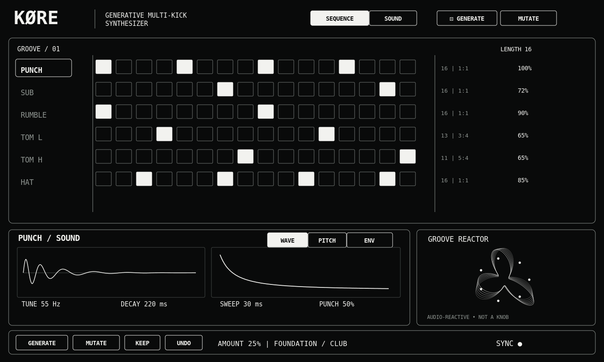
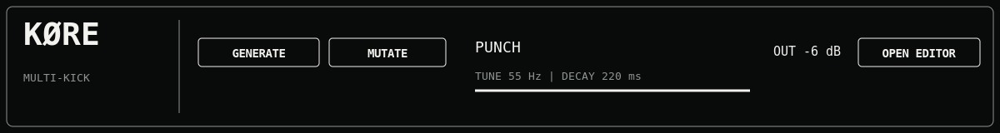

Генеративный многоголосный синтезатор техно-бочек, саба, rumble, томов и
хэтов · Ableton Live 12 · Max for Live Instrument

Версия 1.0 · 10 ноября 2026 · Статус: техническое задание (не готовый
.amxd)

{width="6.7in" height="4.02in"}

Рис. 1. KØRE: новый оригинальный концептуальный макет расширенного
редактора. Мониторинг и DSP здесь ещё не подключены.

# Компактный вид устройства в Ableton

{width="6.6in" height="0.88in"}

Рис. 2. Компактная полоса инструментального устройства; полный редактор
открывается отдельно.

Этот документ объединяет продуктовую архитектуру, требования к звуку,
генератору, интерфейсу и проверкам. Полные дополнительные инженерные
инструкции находятся рядом в Markdown-файлах пакета.

# Полное ТЗ

**Версия:** 1.0 / implementation handoff, 10 ноября 2026

**Статус:** техническое задание, не готовый плагин

**Тип:** Max for Live **Instrument** (.amxd), Ableton Live 12, macOS /
Apple Silicon.

**Нейминг:** только KØRE (символ Ø). Семейство с NØIZ.

**Основной результат:** за один клик получать музыкально применимый,
пробивной techno groove из нескольких взаимодействующих бочек и томов;
затем быстро менять его без разрушения основы.

## 01. Решение задачи и продуктовый фокус

KØRE --- **генеративный multi-kick techno drum synthesizer** с шестью
ролями: **PUNCH, SUB, RUMBLE, TOM L, TOM H, HAT**. Это не обычный
сэмплер и не набор шести одинаковых синтезаторов. У каждого голоса
музыкальная роль и собственный DSP. В первую очередь пользователь должен
за 5--15 секунд сделать: открыть устройство → нажать GENERATE → услышать
устойчивую основу 4-on-the-floor → отредактировать тело бочки →
повернуть AMOUNT и нажать MUTATE → сохранить понравившуюся вариацию
KEEP. Отсутствие ручной настройки до первого звука --- критерий UX, не
жёсткое время исполнения.

**Нельзя:** выдавать случайные 16 битов за techno groove; называть
фотореалистичный mockup реализованным UI; жертвовать синхронизацией ради
анимации; навешивать бесполезные контроллеры; копировать proprietary
исходники, графику или фирменные патчи Fors Opal. У Opal заимствуем
общие \*принципы взаимодействия\*, а не конкретную реализацию.

## 02. Архитектура и границы устройства

> Ableton Live musical transport / host tempo + position\
> ├── Musical scheduler: 6 tracks, per-track length/division + swing +
> groove seed\
> │ └── event generator: step gates → probability → ratchet → per-step
> P-Locks\
> ├── State / preset / undo / keep / deterministic PRNG / Live parameter
> bindings\
> ├── Groove engine: FOUNDATION / DRIVING / HYPNOTIC / BROKEN CLUB\
> │ └── Generate, Mutate, selection scope, P-Lock Chance, Density\
> ├── DSP PUNCH: pitched oscillator + envelope + transient + drive\
> ├── DSP SUB: phase-coherent or independent tuned sub oscillator\
> ├── DSP RUMBLE: filtered delay/reverb FROM kick source, gate / duck\
> ├── DSP TOM L / TOM H: tuned resonant percussion\
> ├── DSP HAT: filtered noise, closed/open articulation (step lock)\
> └── Low-end coordinator: transient priority, sub/rumble duck, DC
> block, stereo sum\
> → stereo gain staging → clip indicator → plugout\~ 1 2\
> UI: compact Live panel + separate expanded editor (SEQUENCE / SOUND)\
> Display telemetry: actual voice envelope + spectrum + groove-reactive
> shape

**Наличие дорожки RUMBLE не означает третий свободно синтезируемый
саб-кик:** по умолчанию это \*эффектный возврат от PUNCH\*, которому
можно отдельно задавать события, гейт и пульсацию. Для одновременных
PUNCH/SUB поддержать две стратегии: **ALTERNATE** (чередование) и
**LAYER** (совпадение с управляемым наложением), по умолчанию HYBRID с
безопасным распределением. Программист не должен автоматически сводить
все низкочастотные роли к одной дорожке.

## 03. DSP: PUNCH (самый высокий приоритет)

**Тракт:** trigger event + velocity → onset phase policy → body
oscillator (sin; дополнительные гармоники через мягкий waveshape) + fast
pitch envelope + transient click → amplitude envelope →
oversampled/anti-alias saturation if feasible → gain compensation →
output.

**Математическая модель sweep (вариант реализации):**

f(t) = f_base × 2 \^ ((sweep_semitones / 12) × exp(-t / tau_sweep))

env_amp(t) = exp(-t / tau_amp) после очень короткого сглаженного входа.
Значения tau рассчитывать от пользовательских миллисекунд (при
необходимости по точке -60 dB), а не считать tau буквально
«длительностью» без пояснения. Для каждого note-on создавать независимое
состояние, чтобы ratchet и переоткрытие не рвали фазу без контроля.

**Главные контроллеры PUNCH, точно по назначению:**

  -------------------------------------------------------------------------------
  **UI**         **DSP**         **Старт**      **Диапазон         **Что
                                                проектирования**   проверять**
  -------------- --------------- -------------- ------------------ --------------
  TUNE           frequency body  55 Hz          ориентир 42--85    фундамент
                 after sweep                    Hz; Advanced шире  реально
                                                                   сдвигается

  PUNCH          макро sweep     50%            0--100%; маппинг   атака
                 depth +                        явный              становится
                 ограниченный                                      острее/мягче
                 sweep time, но                                    
                 НЕ output gain                                    

  DECAY          слышимая        220 ms         100--450 ms        хвост меняется
                 длительность                                      без скачков
                 тела                                              

  DRIVE          управляемая     15%            0--100%            гармоники
                 нелинейность с                                    меняются без
                 loudness                                          безусловного
                 compensation                                      роста
                                                                   громкости

  CLICK          уровень         low            0--100%            атака
  (details)      транзиентного                                     различима на
                 источника                                         малых АС

  LEVEL          постусиление    -6 dB relative -inf...0 dB        независимый от
  (details)                                                        Drive уровень
  -------------------------------------------------------------------------------

Advanced (только если реализовано): SWEEP DEPTH, SWEEP TIME (ориентир
8--100 ms), CLICK COLOR, CLICK LENGTH (1--20 ms), PHASE START. Если
PUNCH макро меняет два параметра, показать связь в подсказке/режиме
Details и закрепить точный mapping в исходниках. Никаких дублирующих
PUNCH/ATTACK с идентичной функцией.

**Принцип клуба:** нет гарантированной «правильной частоты» или LUFS для
каждого зала. Настройки диапазонов --- \*дизайн-ориентиры\*, не
инженерный закон. Пиковый запас на выходе по умолчанию ≈ -6 dBFS в
тестовом пресете; отсутствие клиппинга важнее «максимально громко».
Проверка звучания отдельно на мониторах, наушниках и в миксе с басом.

## 04. DSP: SUB

Синус с детерминированной фазой старта, коротким сглаживанием атаки,
independent DECAY (120--700 ms, старт 280 ms), TUNE (ориентир 35--75
Hz), LEVEL. При **LAYER** рядом с PUNCH использовать настраиваемый /
калибруемый phase start / timing offset, а не слепую автокоррекцию по
мгновенному FFT. По умолчанию SUB тихий и не играет на каждом PUNCH
одновременно. При конфликте со следующим PUNCH включить sidechain duck,
привязанный к envelope PUNCH. Никакого стереорасширения на сабовом
фундаменте.

## 05. DSP: RUMBLE

Source = пост-атака PUNCH (или отдельный фильтрованный tap), затем
фильтрация → delay / diffuse feedback network → decay/tail control →
duck from new PUNCH events → gain. Feedback строго ограничен и
санитизирован (нет бесконечного разгона при смене пресета). Управления
AMOUNT, TAIL, DUCK; по умолчанию реверберационный хвост 350 ms,
умеренный. RUMBLE может иметь собственный step gate для ритмического
включения, но не обязан запускать отдельную «бочку». Проверить переходы
в bypass на щелчки и накопление саб-низа.

## 06. DSP: TOM L, TOM H

Tuned resonator/sine hybrid, pitch envelope (короче, чем у основной
бочки), амплитудная огибающая, лёгкий transient. У каждого TUNE, DECAY,
TONE, LEVEL. TOM L вблизи фундаментальной PUNCH требует low-end
coordination; TOM H должен быть слышен выше кик-бэнда. Не навязывать
отдельный компрессор каждому тому без измеримой задачи.

## 07. DSP: HAT

Noise oscillator → HP/BP spectrum shaping → short/long amp envelope →
LEVEL. Step-level ARTICULATION = CLOSED/OPEN, общий choke group (closed
обрывает open с микро-фейдом). Основной UI: TONE / DECAY / LEVEL. Не
добавлять отдельную седьмую дорожку open-hat без необходимости.

## 08. Low-End Coordinator

-   PUNCH PRIORITY: при совпадении событий не разрушать основную атаку
    --- уменьшать competing sub/tom/rumble на коротком окне, с
    безопасной огибающей.

-   SUB DUCK: применяется по реальному пересечению с PUNCH, а не
    постоянно.

-   RUMBLE DUCK: fast gain dip на PUNCH и release по темпу; менять tail
    не равнозначно duck.

-   MONO LOW: по умолчанию моно низ примерно ниже 100--120 Hz; точную
    частоту фиксировать по тестам и не выносить ручку без необходимости.

-   PHASE: deterministic onset; тест суммы PUNCH+SUB vs отдельные
    дорожки, сравнение waveform, 40--120 Hz RMS/peak. Не «лечить»
    несогласованные тоны одним polarity invert.

-   OUTPUT: DC protection, -6 dBFS headroom in starter preset,
    indication if clipping; limiter optional as safety guard, not
    loudness-maker. Preserve dynamics, no silent excessive
    normalization.

## 09. Event model / schema

> {\
> \"schemaVersion\": 1,\
> \"bpmSource\": \"live\",\
> \"masterSeed\": 148219,\
> \"generationMode\": \"FOUNDATION\",\
> \"bias\": \"CLUB\",\
> \"kickInteraction\": \"HYBRID\",\
> \"amount\": 0.25,\
> \"density\": 0.45,\
> \"pLockChance\": 0.20,\
> \"selectedVoice\": \"PUNCH\",\
> \"voices\": {\
> \"PUNCH\": {\
> \"length\": 16, \"division\": \"1:1\", \"locked\": false,\
> \"params\": {\"tuneHz\": 55, \"punch\": 0.5, \"decayMs\": 220,
> \"drive\": 0.15, \"click\": 0.15, \"levelDb\": -6},\
> \"steps\": \[{\"on\": true, \"velocity\": 1, \"probability\": 1,
> \"ratchet\": 1, \"locks\": {}}\]\
> }\
> }\
> }

JSON above is a **schema sketch**, not a complete 16-step preset:
generator must populate every step. Complete source defines types,
defaults, unit bounds, validation, and versioned migrations. Each track
can be 1--32 steps. Step fields: gate, velocity \[0,1\], probability
\[0,1\], ratchet integer 1--8, locks:{paramId:value}. Optional
microtiming ± offset later. A P-Lock overrides only that note event. It
must not change default voice sound, leak to the next step, or remain
after deleting the lock. All state loaded from Live Set must be
validated/clamped.

## 10. Time engine / polyrhythm

-   Drive from Live transport; calculate timestamps from musical phase
    and beat position; avoid 6 unrelated metros that accumulate drift.

-   Default grid 16th note. 16 steps = one bar in 4/4 for division 1:1.

-   **Polymeter:** 16 vs 13 vs 7 steps at same subdivision.
    **Polyrhythm:** e.g. 3:4, 5:4, 7:4 distribute 3/5/7 hits in the same
    time window where reference has 4. Implement real event timings, not
    UI labels.

-   Suggested timing engine: phase/beat-time → sample-offset scheduling
    where supported. If JS control-rate scheduler produces audible
    jitter, move audio scheduling to signal domain. Never claim sample
    accuracy without host measurements.

-   Probability per event deterministic from seed + track + bar/loop +
    step; no Math.random() with unpredictable re-opened Set behavior.

-   Ratchet: sub-events fit inside step duration; pre-trigger parameter
    state, max 8, avoid double triggers on bar boundary; short decays or
    controlled overlap.

-   Sequence edits while playing: atomic swap at the next bar by
    default, no duplicate events.

-   Transport start/stop, loop jump, tempo changes, time-signature
    changes must reset or continue phase predictably and never cause
    stuck DSP voices.

## 11. Genre-aware generator --- main product feature

GENERATE must build a **coherent techno groove**, not random Bernoulli
steps. Implement order and constraints:

1.  Start from genre profile and GROOVE BIAS (SAFE / CLUB / EXPLORE /
    WILD). Default FOUNDATION + CLUB.

2.  PUNCH foundation: 4/4 at steps **1,5,9,13** (zero-based 0,4,8,12).
    Default protect these four steps except explicit UNLOCK PUNCH or
    BROKEN CLUB mode. Other positions allowed only with controlled, low
    probability and energy budget.

3.  SUB: response to PUNCH or layer selected hit(s), not free
    full-density sine at every sixteenth; assign alternating and
    synchronized roles, avoid overlap with long tails.

4.  RUMBLE: driven by kick excitation and controlled gating/duck;
    moderate by default.

5.  TOM L / TOM H: sparse offbeats and repeating motifs (e.g. 3,7,11 or
    5/7 pulse) rather than random full steps. Occasional short fill near
    bar end; optional polymeter.

6.  HAT: offbeat 8th / sparse 16th variations; open articulation used
    sparingly and choked.

7.  Validate candidate: kicks per bar, max overlapping LF events, peak
    safety estimate, density, genre anchor, repeatability.
    Reject/regenerate candidates violating constraints, bounded
    iteration count, no infinite loops.

8.  Persist seed, whole state, and lock info; baseline 4/4 remains
    audible when other voices muted.

  ----------------------------------------------------------------------------------------
  **Mode**       **PUNCH**             **SUB/RUMBLE**   **TOMS**       **HAT**
  -------------- --------------------- ---------------- -------------- -------------------
  FOUNDATION     strict four-on-floor  restrained tail  rare           offbeats

  DRIVING        four-on-floor +       stronger accent  active         denser
                 occasional controlled responses        syncopations   eighth/sixteenths
                 pickup                                                

  HYPNOTIC       stable four-on-floor  repetitive       polymetric     cyclic phase
                                       interlocking     motifs         displacement
                                       pattern                         

  BROKEN CLUB    allow limited         follow revised   more broken    displaced
                 downbeat              anchor           accents        syncopation
                 omissions/additions                                   
  ----------------------------------------------------------------------------------------

GROOVE BIAS should default CLUB; avoid exposing both BIAS and GENERATION
MODE prominently until testing proves they differ clearly in actual
outcomes. If redundant, merge them into one STYLE selector and keep BIAS
in Advanced.

## 12. Mutate / Keep / Undo (strict semantics)

GENERATE: new whole groove, respects voice locks and chosen scope.
MUTATE: produce candidate from most recent **KEEP anchor**, not
cumulative random drift unless user explicitly accepts it. AMOUNT
defines \*maximum change\*, with low percentage mutating only subtle
hits/velocities/locks while preserving PUNCH foundation. Each press uses
fresh deterministic variationSeed derived from base seed + mutation
counter (avoid identical results).

KEEP: commit candidate to baseline. UNDO: roll back exact prior
user-visible state (full sequencer, sound params, P-Locks, seed, lock
state; no partial reversal). Redo optional. Scope: RHYTHM / SOUND /
P-LOCKS / ALL, Advanced only; default RHYTHM. Per-track LOCK ensures
sound and/or rhythm protection according to lock flags, with visible
state. Do not generate P-Locks on silent steps by default. P-Lock
randomization has \*CHANCE\* (fraction active steps receiving locks) and
\*AMOUNT\* (deviation radius); distinguish them.

## 13. Parameter locks: true voice-specific mapping

Click/select a step, select sound parameter, edit value. Per-step lock
map uses actual parameter IDs valid for that voice only (for instance
PUNCH.tuneHz, not an unused generic knob). Little white marker on a
locked step. Parameter lock applied just before corresponding trigger
for both normal and ratcheted events. If step off, stored P-Locks can be
retained but do not create phantom audio. Copy/paste lock, clear one,
clear all optional secondary actions. Random locks follow min/max sonic
constraints; SUB tuned variation should not jump arbitrarily several
octaves at every hit by default.

## 14. UI / visual design source of truth

**Family resemblance with NØIZ, but DIFFERENT product layout.** Pure 2D
mono: background #090A0A, panel #111313, active #F2F2F0, disabled
#515754, line #7D8380, no glow, bevel, texture, gradients, 3D hardware
knobs. Minimalist technical graphics and circular/filament nodes
\*only\* if legible and functional. Reference images in reference/ for
mood; original UI drawn to own grids in assets/.

**Expanded layout target 1200×760 CSS-like reference pixels (design
spec, not guaranteed Max window dimensions):**

-   top 58: logo KØRE, device status, Generate (dice), Mutate,
    Keep/Undo, Page SEQUENCE/SOUND.

-   main area 450: on Sequence: six 16-step rows at readable size,
    user-selectable voice, step markers, right contextual strip for
    length/ratio/probability; on Sound: selected voice, large waveform +
    pitch-time sweep, compact core controls.

-   bottom 180: selected voice mini-synth / sound map, LF meter and one
    meaningful reactive coil, transport state; avoid duplicate visible
    control rows.

-   live device compact: height determined by host, never cram 760px UI
    into device chain; show KØRE, current patch, GENERATE, MUTATE,
    master output meter, Open Editor.

-   Three design invariant priorities: 1) understand groove in 1
    glance, 2) access punch-body controls in 1 click, 3) react to sound
    without false visualization.

**Control hitboxes:** clicking whole node selects; **left-button drag
vertically** maps ↑=larger, ↓=smaller, Shift fine adjust, double click
reset; show numeric value persistent. Reactive filaments map to
envelopes/level for corresponding voice, NOT autonomous random noise;
audio-rate visual data downsampled/capped to ≤30 FPS initially. Stop
drawing when editor hidden if possible; DSP unaffected.

**Elements removed from main screen:** separate limitless FX matrix,
redundant phase knob with no tested DSP, numerical analysis grid that
users cannot interpret, decorative full-screen spirals, real-time input
mode toggles that overlap functions. Low-End Coordinator remains
accessible in advanced panel but defaults safe.

## 15. Max for Live production requirements

9.  Create a genuine **Max Instrument** through Live/Max templates or
    project properties, not an ad hoc JSON wrapper masquerading as
    .amxd.

10. Use appropriate plugout\~ stereo, Max/JS scheduling and MSP patches
    as actual functional graphs. live.thisdevice init / enable state as
    needed.

11. Build explicit dependency graph, document exact Max objects/external
    licenses; prefer native objects, no nonredistributable compiled
    externals.

12. Store state in Live Set reliably (preset data, steps, clocks,
    P-Locks, mutation anchor, optional theme); verify reopen, duplicate
    track, save as.

13. Implement compact presentation and separate editor window; when
    editor closed, still audible & controllable.

14. Save device, freeze dependencies using **Max\'s native Freeze then
    Save**, load the frozen .amxd on a clean test project with original
    source folder removed. Confirm no missing JS or abstraction.

15. Measure host CPU and timing at buffer 64/128/256, 44.1/48 kHz,
    120/130/145 BPM. Do not promise sample-accurate performance until
    tested.

16. UI must not rebuild DSP on redraw. Set normalized parameter
    mapping/automation so Ableton automation behaves deterministically.

17. Any setting without DSP mapping or a test fails code review.

## 16. User journey / UX acceptance

Drop real .amxd onto Live 12 MIDI track → compact KØRE appears → hit
GENERATE → transport runs and output audible → select PUNCH → drag DECAY
node up/down → waveform and actual tail respond → MUTATE 15% → main
four-on-floor survives → KEEP → change tom rhythm → re-open Live Set and
all state recalled.

If any leg fails, release is **not done**, even if .amxd extension is
present. Clean-install check essential due to earlier NØIZ packaging
failures.

## 17. Explicit priorities / phase gates

**P0 Host probe:** Ableton/Max environment + genuine Instrument template
loaded (screenshot/log). **P1 PUNCH DSP** audible and measurable. **P2
SUB + low-end interaction**, A/B overlap. **P3 scheduler + six tracks +
4-on-floor generate**, real transport. **P4 Mutate/Keep/Undo + locks**,
deterministic. **P5 RUMBLE / TOMS / HAT** with individual sound checks.
**P6 Expanded UI + compact UI** (faithful to SVG). **P7 Host tests,
save/restore, safety, CPU**, defects fixed. **P8 frozen self-contained
.amxd release**, rollback to last working if failing. Never mark
untested pass.

## 18. Measurement and acceptance matrix

See ACCEPTANCE_TESTS.md for unique A01--A36 cases and evidence standard.
For DSP thresholds, use meaningful qualitative and quantitative checks
rather than fake one-number certification; document measured test
conditions and before/after waveforms.

## 19. Non-goals of first release

No external sample browser, no standalone VST/AU, no AI API, no
audio-to-MIDI transcription, no integrated mastering/maximizer, no 64
voices, no unnecessary FX racks, no speculative phase correction without
signal tests. Additional kick algorithms only after primary voice sounds
excellent in context. Preset export may be V1.1.

## 20. References and source boundaries

-   Ableton synthesis and kick design material (background;
    frequency/timing suggestions are project choices, not normative
    standards).

-   Fors Opal official docs (interaction inspiration, no copied UI/DSP).

-   Max official:
    https://docs.cycling74.com/userguide/m4l/live_freezing/ ;
    https://docs.cycling74.com/userguide/m4l/live_sharing/ ;
    https://docs.cycling74.com/reference/live.thisdevice

**Source-of-truth order:** this KORE_MASTER_SPEC.md → DSP_ENGINE.md /
RHYTHM_ENGINE.md / UI_DESIGN.md → ACCEPTANCE_TESTS.md → reference
images. Resolve conflicts explicitly in changelog; never silently change
user-approved priorities.

# DSP: звуковой движок

## DSP blocks and route

> PUNCH note → oscillator(phase reset) → pitch glide → amp envelope ┐\
> click(noise with fade) → trim ├→ saturation/trim → transient out
> ────┐\
> SUB note → sine(phase reset) → short glide → amp env → gain ───────┤→
> low-end duck / phase onset ─────────┤\
> PUNCH tap → HP/LP → diffused delay/reverb → dynamic duck → RUMBLE ─┘
> ├→ stereo mixer/DC block/out\
> TOM L & H note → tuned resonator + damp → gain
> ────────────────────────────────────────────────────────────┤\
> HAT note → noise → HP/BP → CHOKE → gain
> ───────────────────────────────────────────────────────────────────┘

DSP must not allocate memory or call heavy JS graph animation in
realtime audio callback. Telemetry downsampled and updated by UI
scheduler. All dynamic gains fade/smooth. Preclude denormals and runaway
feedback.

## Per-voice parameter contract

  ----------------------------------------------------------------------------------
  **Voice**      **Exposed      **Unit**       **Does exactly**   **Verification**
                 macro**                                          
  -------------- -------------- -------------- ------------------ ------------------
  PUNCH          TUNE           Hz             shifts settled     FFT stable tail
                                               body pitch         peak

  PUNCH          PUNCH          \%             changes pitch      spectrogram onset
                                               envelope attack    
                                               depth/time by      
                                               explicit curve     

  PUNCH          DECAY          ms             changes audible    tail energy time
                                               body decay         

  PUNCH          DRIVE          \%             harmonic           harmonics, matched
                                               saturation;        RMS A/B
                                               compensate output  
                                               loudness           

  PUNCH          CLICK          \%             highpassed onset   initial 1--20 ms
                                               transient amount   energy

  PUNCH          LEVEL          dB             post voice gain    RMS gain
                                                                  difference

  SUB            TUNE           Hz             shifts sub         FFT peak
                                               oscillator         

  SUB            DECAY          ms             controls sub tail  tail duration

  SUB            LEVEL          dB             controls output    measured gain

  RUMBLE         AMOUNT         \%             processed wet      tail RMS
                                               level              

  RUMBLE         TAIL           ms             bounded feedback   decay length
                                               time               

  RUMBLE         DUCK           dB/%           kick-triggered dip gain reduction on
                                               in tail            PUNCH

  TOM L/H        TUNE           Hz             pitch resonator    tone spectrum

  TOM L/H        DECAY          ms             damped tail        waveform

  TOM L/H        TONE           \%             bandwidth/timbre   spectral centroid

  TOM L/H        LEVEL          dB             output gain        RMS

  HAT            TONE           \%             HP/BP frequency    centroid

  HAT            DECAY          ms             length of          time envelope
                                               closed/open note   

  HAT            LEVEL          dB             gain               RMS

  HAT step       OPEN/CLOSED    enum           open duration and  overlap test
                                               choke interaction  
  ----------------------------------------------------------------------------------

**Prohibited:** dummy controls, a \'phase align\' button without
measured action, independent click pitch if no need, FX selectors that
do not switch processing, 4 identical wavetable voices with labels
changed.

## Core physical design guides (not universal mastering standards)

-   PUNCH settled fundamental approximate starting 42--85Hz, typical
    preset 55Hz; initial sweep approximately 100--500Hz and 8--100ms,
    default example start 230Hz / 30ms.

-   PUNCH body approximately 100--450ms audible tail, default 220ms; SUB
    120--700ms default 280ms; CLICK 1--20ms default 5ms.

-   RUMBLE 150--1000ms with active PUNCH duck. LOW TOM below HIGH TOM,
    musically tuned per pattern.

-   Use phase and sample timing tests across 44.1 / 48 kHz and host
    buffers. Test stereo-to-mono summation for bass reliability.

-   Do not assert that a single fundamental frequency, compressor ratio
    or LUFS target guarantees club performance.

## Anti-click and output policy

-   Retrigger note handling: ramp old component or polyphony; no
    instantaneous discontinuity when note-on repeats.

-   Voice count and reverb feedback are bounded. UI redraw never changes
    audio samples.

-   Clip indicator monitors post-mix output. Internals may exceed 0 dBFS
    float as needed, but output is trimmed; no hard digital clipping in
    test preset.

-   All parameter changes smooth where needed; automation extremes are
    stable even at fast tempo.

-   Save 10-s audio A/B render for each macro plus silent/muted voice
    test.

## Low-end modes

-   ALTERNATE: SUB scheduled on complementary steps, explicit overlaps
    are still allowed if user edits.

-   LAYER: aligned or intentionally offset onset on same steps;
    compensate level when combined.

-   HYBRID: default musical algorithm can combine both with density
    constraint.

-   Mono low end as default signal architecture; optional width only to
    high-frequency rumble decorations, not fundamental.

## Start order

PUNCH alone → SUB w/ PUNCH → feedback-safe RUMBLE → TOMS → HAT. Each
stage requires audio comparison and latency/peak logging before
proceeding. No visual redesign until pass.

# Ритмический движок

## Timing semantics

At BPM 130, quarter = 60/130 = 461.538ms, eighth = 230.769ms, sixteenth
= 115.385ms. division=1:1 is reference 16ths. Polymeter changes length
only; true polyrhythm changes period/phase. Do not label unequal step
lengths as \'3:4\' without the corresponding time transformation. Use
one Live-derived musical phase to schedule all voices.

## Track data structure

> Track { id, length:1..32, division:{numerator,denominator},\
> mode:Forward \| PingPong(optional), lockedRhythm, lockedSound,\
> voiceParams, steps: Step\[32\] }\
> Step { on:Boolean, velocity:0..1, probability:0..1, ratchet:1..8,\
> articulation?:Open\|Closed, locks:Map\<validVoiceParamId,
> normalizedOrPhysicalValue\> }\
> Pattern { tracks\[6\], generationStyle, grooveBias, kickInteraction,\
> masterSeed, mutationCounter, keepAnchor, undoStack, version }

P-Lock parameter IDs/units must be the same as real DSP mappings. Avoid
edge case \'P-Lock bleeds into subsequent unmodified hit\'. All random
generation is seeded, replayable on Live Set restore. Event queue needs
event-ID deduplication across segment boundaries.

## Genre-aware groove algorithm (pseudocode)

> generate(style, bias, seed, constraints):\
> rng = seededPRNG(seed)\
> candidate = emptySixVoicePattern()\
> candidate.PUNCH = \[0,4,8,12\] // default strict 4-on-floor\
> if style == BROKEN_CLUB && punchUnlocked:\
> optionally omit / shift limited anchor with groove acceptance check\
> candidate.SUB = placeResponsiveSub(rng, candidate.PUNCH,
> kickInteraction, maxLowOverlap)\
> candidate.RUMBLE = createGatedKickReturn(candidate.PUNCH,
> moderateTail)\
> candidate.TOM_L = sparseSyncopatedMotif(rng, style,
> avoidHeavyKickOverlap)\
> candidate.TOM_H = complementaryMotif(rng, style, allowOccasionalFill)\
> candidate.HAT = offbeat8thsWithSparse16ths(rng, style,
> openClosedChoke)\
> applyDynamicsHumanizeWithBoundedOffsets(candidate)\
> applyOptionalRandomPLocks(candidate, chance, amount, voiceSafeRanges)\
> assert(validateGroove(candidate, style, bias))\
> return candidate

Allow at most N attempts (e.g. 16) then return conservative FOUNDATION
pattern, never infinite rerolls. Musical quality is assessed by actual
blind listening and simple objective constraints; do not claim an
objective AI score without tests. PUNCH preserved in
FOUNDATION/DRIVING/HYPNOTIC by default; user can manually edit anything.

## Mutate policy

> mutate(keepAnchor, amount, scope, mutationCount):\
> copy = deepClone(keepAnchor)\
> rng = seededPRNG(hash(masterSeed, mutationCount++))\
> for each unlocked track:\
> choose bounded structural edits weighted by track role:\
> PUNCH: mostly velocity, subtle click/timing, preserve 0/4/8/12\
> SUB: sparse alternation/response changes and minor sound variation\
> RUMBLE: wet/tail/duck variation with safety limits\
> TOMS: some step shifts, 8/12/16 cycles, fills\
> HAT: denser accents, open/closed and probabilities\
> if scope PLOCKS only: on-step locks only, control chance and depth
> separately\
> validateGroove(copy)\
> return copy

AMOUNT=0 is exact bitwise no-op except UI notification; AMOUNT≈10--20%
subtle, ≈50% moderate, ≈100% strong but limits remain. KEEP updates
anchor to current candidate. UNDO restores immediate complete previous
snapshot; distinct from anchored mutation. LOCK prohibits updates. When
playback running, commit edits at bar boundary to prevent duplicated
steps.

## Probability / ratchet / step overrides

-   On each logical event: use seeded Bernoulli for probability; then
    emit ratchet subevents within actual step interval; apply that
    step\'s P-Locks for all subevents.

-   Ratchet should not fire at or beyond next step boundary unless
    explicit overlap behavior specified.

-   Ratchet from PUNCH main beats OFF by default; tom/hat fills first.

-   Step volume (velocity) maps to amp and optionally mild timbre if
    defined; no hidden mapping.

-   Notes at exact transport loop boundary fire once, not 0 or 2 times.

## Genre mode recipes

  ----------------------------------------------------------------------------------
  **Style**      **Main kick**        **Sub/Rumble**   **Toms**       **Hat**
  -------------- -------------------- ---------------- -------------- --------------
  FOUNDATION     every quarter        restrained       rare           offbeat

  DRIVING        quarters +           slightly more    moderately     more 16ths
                 controlled ghost     response         active         

  HYPNOTIC       quarters always      cyclic/offset    simple         repeating
                                      motifs           polymeter      displacement

  BROKEN CLUB    recognizable pulse,  adapts           syncopations   breaks /
                 selective                                            accents
                 missing/additional                                   
                 hit                                                  
  ----------------------------------------------------------------------------------

## Acceptance gates

-   Generate 1000 seeded patterns and assert PUNCH anchors present for
    three stable modes; validate density/overlap bounds.

-   Same seed+settings returns same complete pattern; changing mutation
    counter returns a different candidate for nonzero amount.

-   At 3:4 test three equally spaced impulses in same span as four
    reference quarter notes; compare sample timestamps with tolerance
    stated by runtime.

-   Save/reopen tests restore base seed, kept anchor, P-Locks, audible
    mix and running state safely.

# Дизайн и UX

## Visual direction

Family of NØIZ: flat pure black/white digital technical interface. **Not
a clone:** KØRE has a more prominent pitch-envelope + waveform in SOUND
view; SEQUENCE 6 rows and separate low-end status. Reference:
assets/KORE_expanded_wireframe.png and
assets/KORE_compact_wireframe.png, editable SVG versions included.
Reference screenshots in /reference are inspiration, not assets to
reproduce pixel-perfect.

Palette: background #090A0A; panel #101212; stroke #858A86; text
#F3F3EF; inactive #3C413F. One visually effective accent = inversion
white fill / black text, **no colored theme required in V1**. Fonts:
clear neutral sans; bitmap/monospace digits for ratios, steps,
frequency. Don\'t rely on unavailable bundled fonts. Borders one pixel,
no shadows/material/reflections.

## Expanded editor: tabs and priorities

### SEQUENCE tab

-   Header KØRE \| SEQUENCE/SOUND \| preset \| dice Generate \| Mutate
    \| Keep/Undo \| Close.

-   Main ≈ 64% width: **six horizontal tracks** PUNCH / SUB / RUMBLE /
    TOM L / TOM H / HAT, each 16 visible hit cells, alternate page steps
    17--32; current beat marker. Voice select at row label; click cell
    toggles step. P-Lock dot is distinct from active gate.

-   Right area: contextual LENGTH, RATE/POLY, PROB, and STEP options for
    selected voice; do not repeat six full stacks of knobs.

-   Bottom: AMOUNT, STYLE (4 options), GROOVE BIAS hidden under ADVANCED
    if redundant, per-voice lock icon. A small **real audio-reactive
    coil** may visualize active low-end, never obscure beat cells.

### SOUND tab

-   Selected voice from shared selector; prominent **actual waveform**
    and **pitch-vs-time graph** (not fabricated data), with labels in
    Hz/ms; spectrum overlay optional.

-   Primary four reactive nodes for PUNCH: TUNE, PUNCH, DECAY, DRIVE;
    compact CLICK/LEVEL in DETAILS. Other voices show only their
    legitimate macros, e.g. SUB three nodes, not dummy fourth.

-   Coil visualization receives measured envelope / measured trigger
    intensity. Moving points follow waveform-derived energy; 0 input →
    calm rotation, strong transients → bounded deformation. Affects
    audio **never**; UI REACTIVITY is fixed internal mapping, not
    another knob.

-   Low-end coordinator hidden under a small LOW END details tab (Kick
    Priority auto/default; Sub Duck, Rumble Duck, Mono low and phase
    diagnostic only when implemented).

## Compact strip (in Ableton device chain)

Minimum content: KØRE logo, active preset, GENERATE, MUTATE, selected
voice, PUNCH DECAY/TUNE or one priority macro, small output meter and
OPEN EDITOR. This is an actionable minimal instrument, not a dead white
dial. Live device height is host-constrained; do not claim the full
canvas is displayed in the chain. Use a separate Max editor window
through genuine Max APIs and test focus/closing. Do not assume arbitrary
browser technology works inside Max.

## Gesture contract

-   Left mouse press anywhere inside circular filament-node hit area +
    drag UP/DOWN, sensitivity deterministic and scaled; Shift = fine;
    double-click default; hover shows full label/real unit; value always
    text-visible.

-   Generate short click uses configured style, preserving locked
    tracks; Mutate produces variation from KEEP anchor, Keep commits,
    Undo rollback.

-   GUI status must show when Live transport is stopped / whether
    pattern queued for next bar.

-   UI performance capped 30 fps to start; no dependence on a separate
    window remaining open.

## Usability tests

-   A new user should generate groove, mutate, select SUB, adjust
    volume, and return to PUNCH within 60 seconds without manual.

-   All interactive zones ≥ 24px high in expanded editor; critical
    buttons ≥ 36px.

-   Do not rely solely on audio reactive spiral to convey selected
    voice, progress or clip status.

-   No invisible clickable geometry or decorative extra knob.

## Key visual difference versus NØIZ

NØIZ = noise and granular textures, 4 voices. **KØRE = transient-driven
multi-kick with a dual waveform/pitch-editing surface and 6 voices**,
using the same family iconography and monochrome tone.

# План реализации

  ------------------------------------------------------------------------------------
  **Gate**                **Deliverable**                     **Stop/go evidence**
  ----------------------- ----------------------------------- ------------------------
  P0                      Genuine Max Instrument stub         Loads in MIDI device
                                                              chain as Instrument,
                                                              stereo plugout\~ present

  P1                      PUNCH audible DSP                   Render ten kicks at 130
                                                              BPM, measure
                                                              tune/sweep/decay/drive
                                                              changes, no artifacts

  P2                      SUB + low-end coordinator           A/B alternate/layer,
                                                              phase & 40--120Hz energy
                                                              logged, transient
                                                              preserved

  P3                      Transport-aware 6-track sequence    Pattern playback
                                                              120/130/145 BPM,
                                                              loop/stop/start, real
                                                              3:4/5:4/7:4 timing

  P4                      Generate/Mutate/Keep/Undo/P-Locks   seeded repeatability +
                                                              locked voices + full
                                                              state undo tests

  P5                      Rumble/Tom/Hat                      six voice audible
                                                              distinctions, bounded
                                                              feedback, choke, P-Lock
                                                              audible differences

  P6                      Expanded + compact UI               monochrome visuals,
                                                              vertical-drag gestures,
                                                              working open/close, no
                                                              dummy knobs

  P7                      Host regression, recall and safety  CPU, buffer, 44.1/48k,
                                                              exported audio,
                                                              load/save/reopen and
                                                              automation

  P8                      Frozen self-contained .amxd         Freeze then Save in Max,
                                                              clean-path install /
                                                              second test Live Set
                                                              passes
  ------------------------------------------------------------------------------------

## Workflow discipline

18. Start each gate by listing exact modules, tests and explicit known
    unknowns.

19. Build the smallest runnable unit, not one large opaque patch.

20. Add source control commits per gate, maintain log with screenshots
    and short audio test renders.

21. Run JS unit tests and patcher structural checks, **then** actual
    Max/Ableton host tests. Neither alone equals completion.

22. Keep TEST_REPORT.md per case PASS/FAIL/NOT TESTED. Block release on
    critical fails.

23. If Max/Live inaccessible, deliver source with host steps and mark
    host-only checks NOT TESTED. Never fabricate .amxd by hand.

## Minimal test project

Live 12 blank Set, MIDI track with KØRE.amxd, tempo 130, 4/4, no other
plugins, audio meter visible. Save, quit Live, reopen, run
Generate/Mutate/Keep/Undo and compare expected pattern IDs. Move device
to new Set without source folder; missing JS = FAIL.

## Product scope control

Any proposed new control requires: a) unique sonic/musical purpose, b)
state schema, c) DSP/scheduler mapping, d) measured acceptance test, e)
UI location. Reject controls lacking any one of these. New screens and
more voices require explicit scope change, not developer guesswork.

# Приёмочные испытания

Record per test: PASS / FAIL / NOT TESTED, machine/Max/Live versions,
test steps, expected vs observed, screenshot/audio/log path. **Never
mark PASS based solely on static code inspection.** Critical tests
marked \* block release.

  -----------------------------------------------------------------------
  **ID**                              **Test / expected outcome**
  ----------------------------------- -----------------------------------
  A01\*                               Native .amxd loaded as a Max
                                      Instrument in Live 12 MIDI track,
                                      no Drop Instrument Here as
                                      consequence of wrong device type.

  A02\*                               PUNCH plays on a trigger and routes
                                      stereo audio through plugout\~.

  A03\*                               In PUNCH TUNE changes settled
                                      fundamental (FFT measurement).

  A04\*                               PUNCH changes onset pitch sweep,
                                      not merely volume.

  A05\*                               DECAY changes tail with stable
                                      re-trigger, no hard discontinuity.

  A06\*                               DRIVE changes harmonics with useful
                                      output compensation, not unbounded
                                      peak gain.

  A07                                 CLICK changes high-frequency
                                      attack, not fundamental pitch.

  A08\*                               SUB voice audible independently and
                                      tunable.

  A09\*                               PUNCH/SUB alternating sequence
                                      plays correct steps without
                                      unexpected layering.

  A10\*                               PUNCH/SUB layered sequence remains
                                      controlled in peak and 40--120Hz
                                      bass coherence.

  A11\*                               Sub Duck attenuates only on real
                                      PUNCH overlaps and releases
                                      smoothly.

  A12                                 RUMBLE wet tail follows kick
                                      source; no runaway feedback after
                                      several minutes.

  A13                                 RUMBLE duck exposes PUNCH attack;
                                      bypass click-free.

  A14                                 TOM L and TOM H independently
                                      audible and distinct pitch ranges.

  A15                                 Hat open/closed articulations and
                                      choke work at high tempo.

  A16\*                               Six lanes play independently, each
                                      with adjustable length 1--32.

  A17\*                               16-step reference at 130 BPM plays
                                      4-on-floor at 0/4/8/12 correctly.

  A18\*                               Polymetric lengths 16/13/7 stay
                                      phase coherent to shared Live
                                      transport.

  A19\*                               3:4, 5:4, 7:4 generate real timing
                                      divisions; documented measured
                                      offset tolerance.

  A20\*                               Tempo changes 120→145→130 without
                                      scheduler drift/double events.

  A21\*                               Loop/restart and stop/start yield
                                      no duplicate first/last triggers or
                                      stuck tails.

  A22                                 Ratchet 1--8 fits chosen step
                                      period, no boundary double-fire.

  A23                                 Probability=0 never fires; =1
                                      always fires, intermediate
                                      deterministic with seed.

  A24\*                               FOUNDATION Generate keeps
                                      four-on-floor PUNCH at zero-based
                                      \[0,4,8,12\].

  A25                                 DRIVING/HYPNOTIC produce musically
                                      distinguishable pattern structures
                                      while keeping kick anchor.

  A26                                 BROKEN CLUB can selectively unlock
                                      anchor, still sounds
                                      rhythmic/controlled.

  A27\*                               Same seed+settings → same generated
                                      sequence including P-Locks after
                                      reopen.

  A28\*                               Mutate Amount=0 leaves anchor
                                      untouched; 15% retains main kick
                                      beats.

  A29\*                               Sequential nonzero Mutate presses
                                      produce distinct variations from
                                      KEEP anchor, not same seed
                                      repeated.

  A30\*                               KEEP changes anchor; UNDO restores
                                      exact prior rhythm+sound+lock
                                      state.

  A31\*                               P-Lock affects only selected step
                                      and correct DSP macro, no leakage.

  A32\*                               Random P-Lock Chance=0 yields no
                                      new locks; Chance=1 yields locks on
                                      appropriate active steps.

  A33\*                               Compact UI works; full editor
                                      opens, shows controls, closes
                                      without muting DSP.

  A34\*                               Node left-drag ↑/↓ changes correct
                                      value and sound; Shift fine,
                                      double-click resets.

  A35\*                               Save Live Set, restart, recall all
                                      patterns, sound, seed, anchor,
                                      tempo behavior; no missing files.

  A36\*                               Freeze+Save, clean-path install and
                                      empty project playback; no missing
                                      JS/assets, no catastrophic CPU, DC,
                                      clipping or runaway feedback.
  -----------------------------------------------------------------------

## Performance and reliability protocol

Sample rates 44.1/48kHz, buffer 64/128/256, 120/130/145BPM. Log CPU
under six active voices + rumble for 5min, record plugin output and
measure peak/RMS/low band. Check no \>0 dBFS floating output on default
preset. Compare offline render vs real-time render tolerances. Host
environments vary; set measurable tolerances from repeatable test
conditions rather than asserting sample accuracy without tests.
