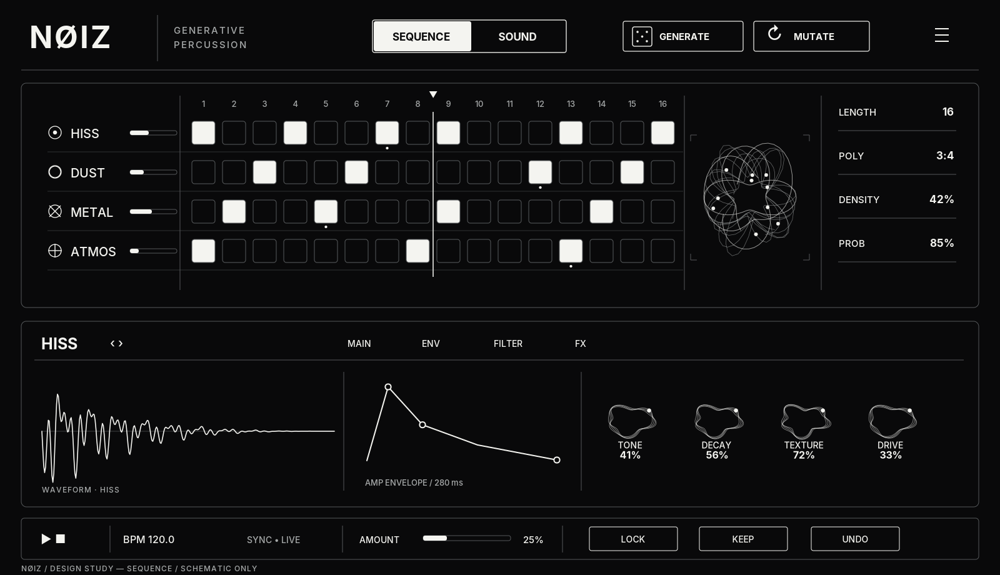
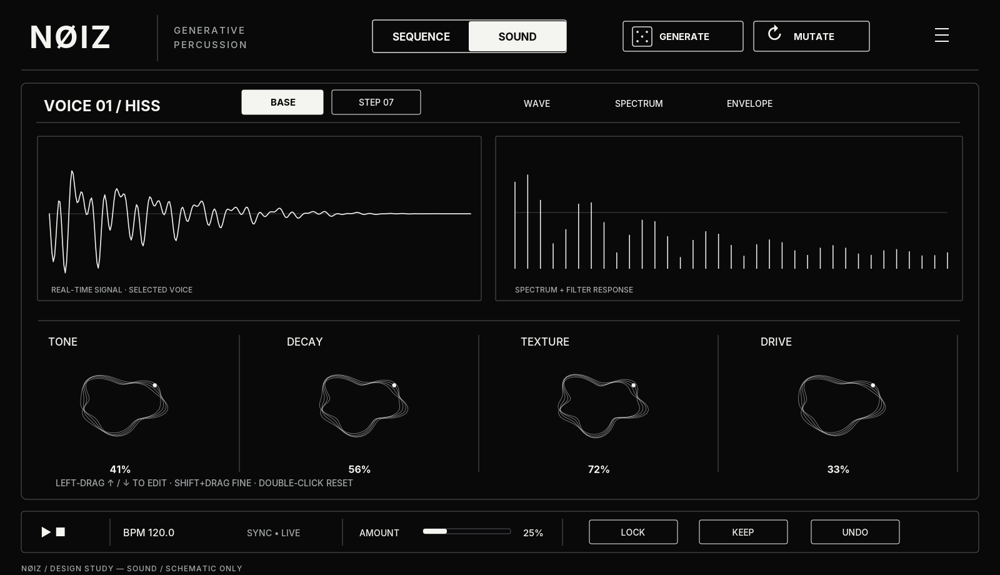
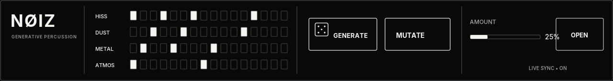
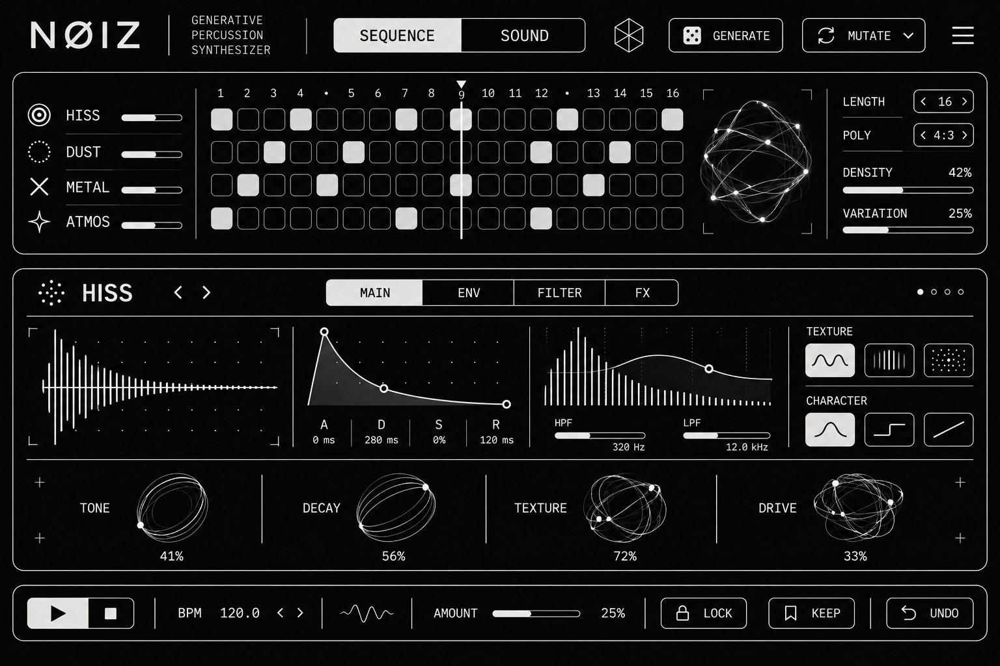

**NØIZ**

**GENERATIVE PERCUSSION SYNTHESIZER**

**ТЕХНИЧЕСКОЕ ЗАДАНИЕ / ПОЛНАЯ КАРТА РАЗРАБОТКИ**

Для Claude Code · Ableton Live 12 · Max for Live · macOS / Apple Silicon

**Название: NØIZ --- только с перечёркнутой Ø.**

Цель: генерация осмысленной техно-перкуссии за 1--3 действия; Mutate,
Keep, Step P-Locks, самостоятельный звуковой синтез и строгий
монохромный интерфейс.

**Состав пакета**

> --- Мастер-спецификация: функциональность, DSP, тайминг, структура
> данных, UX.
>
> --- Эскизы Sequence, Sound и Compact с привязкой к Max for Live.
>
> --- План P0--P8, тест-матрица A01--A26, инструкции и ограничения
> сборки.
>
> --- Обязательное правило: настоящий .amxd подтверждается только
> открытием в Ableton Live.

**СТАТУС: ПРОЕКТНОЕ ТЗ · НЕ ГОТОВЫЙ ПЛАГИН**

# UI 01 / SEQUENCE --- основной рабочий экран

{width="6.65in" height="3.82375in"}

Точный UX-эскиз. Секвенсор 4 × 16, автономные циклы, клубок нитей
справа, Sound Quick Editor и действия Generate/Mutate/Keep/Undo. Это
векторная схема, не скриншот работающего плагина.

# UI 02 / SOUND --- большой редактор звука

{width="6.65in" height="3.82375in"}

Точный UX-эскиз. Wave / Spectrum, режим BASE / STEP и четыре ноды с
вертикальным drag-управлением. Анимации должны отражать реальные
параметры и амплитуду.

# UI 03 / COMPACT --- узкая область Ableton

{width="6.65in" height="0.8780074365704287in"}

Размер по вертикали --- 169 px; реальная компоновка должна быть
проверена внутри Live. Отдельное окно открывает полный редактор.

# Ранее одобренное визуальное направление

{width="6.65in" height="4.433333333333334in"}

Референс эстетики NØIZ (генерированный концепт): почти чёрный + белый,
контурная 2D-графика, клубок нитей, четыре живые ноды. Использовать как
визуальное руководство, НЕ как доказательство готовой реализации.

# Основная техническая спецификация

*Далее --- полный текст задания. Разделы 01--20 совпадают с
NØIZ_MASTER_SPEC.md, который нужно отдать Claude Code как
первоисточник.*

**Версия задания:** 1.0 / 10 ноября 2026 г.\
**Назначение:** техническое задание + продуктовая карта +
дизайн-система + контрольный список для Claude Code.\
**Платформа:** Ableton Live 12, Max for Live Instrument, macOS / Apple
Silicon.\
**Название в интерфейсе:** **NØIZ** (латинская Ø --- НЕ NOIZ, NOISE,
Noiskat или NØISE).\
**Референс механик:** Fors Opal --- изучить принципы, НЕ копировать его
исходный код, графику, названия движков или собственные алгоритмы.

> **ВАЖНО ДЛЯ ИСПОЛНИТЕЛЯ:** это спецификация ЦЕЛЕВОГО продукта, а не
> заявление, что устройство уже существует. Предыдущие .amxd в этой
> истории были экспериментальными, загружались некорректно и не являются
> эталонными сборками. Не выдавай текстовый .maxpat или файл с вручную
> созданной оболочкой .amxd за проверенный плагин. Создавай устройcтво
> из нативного шаблона **Max Instrument** в Ableton/Max, сохраняй и
> замораживай зависимые файлы штатным способом; каждую стадию честно
> маркируй как static check / host loaded / audible tested.

## 01. Краткое продуктовое определение

**NØIZ** --- самостоятельный генеративный перкуссионный синтезатор для
Max for Live. Его главная задача: **за 1--3 действия получить музыкально
осмысленный, необычный техно-грув и мгновенно развивать его без потери
понравившегося рисунка.** Инструмент синтезирует перкуссию на лету, без
обязательных аудиосэмплов. Четыре независимых голоса: HISS, DUST, METAL,
ATMOS. Независимые циклы, деления, Probability, Ratchet, Step Parameter
Locks и их рандомизация.

**Главный пользовательский маршрут:**

DROP DEVICE → PLAY → \[🎲 GENERATE\] → \[MUTATE\] → \[KEEP\] → EDIT
STEPS / SOUND → SAVE LIVE SET

Пользователь не должен 10 минут выставлять настройки, чтобы услышать
первый качественный ритм. Шаблонный первый пресет должен изначально
звучать музыкально; при Generate --- немедленно давать другую пригодную
комбинацию.

**Приоритеты строго по убыванию:**

> 1\. Надёжно загружается как **Max Instrument** и выдаёт звук.
>
> 2\. Правильный стабильный музыкальный тайминг и независимые
> ритмические дорожки.
>
> 3\. Качественная шумовая перкуссия и действительно полезные
> тембральные макросы.
>
> 4\. Musical Generate / Mutate / Keep / Undo, включая рандомные
> P-Locks.
>
> 5\. Моментальная понятность и управление с одного экрана.
>
> 6\. Уникальный, строгий, отзывчивый чёрно-белый UI.
>
> 7\. Аудиореактивные ноды и клубок нитей --- только после
> подтверждённой стабильности DSP.

**Это НЕ:** копия Fors Opal, сэмпл-пак, MIDI-only effect, эффект на
входном аудио, фотореалистичная драм-машина, модульный синт с сотнями
ручек, самостоятельный AU/VST.

## 02. Критерии успеха и реальные сценарии

### User stories

> • **US-01 / Первый звук:** открываю .amxd на MIDI-дорожке Live 12,
> включаю транспорт, нажимаю Generate --- слышу четыре разноплановых
> перкуссионных голоса с осмысленными паузами.
>
> • **US-02 / Вариация:** мне нравится ритм, ставлю Amount=15%, жму
> Mutate --- грув узнаваем, но несколько событий изменились; Keep
> принимает новую точку отсчёта.
>
> • **US-03 / Рандомный тембр на шагах:** фиксирую ритм, включаю RANDOM
> → P-LOCKS, меняю Lock Density и Lock Amount, получаю разнообразие
> звука отдельных ударов без изменения базового пресета.
>
> • **US-04 / Ручное управление:** нажимаю шаг, вижу его параметры,
> настраиваю Tone/Decay/Texture/Drive; маленькая точка или засечка
> показывает P-Lock.
>
> • **US-05 / Полиритмия:** ставлю HISS 16/1:1, DUST 13/1:1, METAL
> 7/3:4, ATMOS 5/5:4; дорожки не сбиваются и синхронны Live.
>
> • **US-06 / Саунд-дизайн:** зажимаю **левую кнопку мыши внутри всей
> области ноды Tone**, тяну вверх --- слышимо ярче, значение растёт;
> вниз --- темнее. Во время удара формы нод реагируют на энергию звука.
>
> • **US-07 / Возврат:** не нравится генерация --- Undo возвращает и
> паттерн, и P-Locks, и применённые настройки в нужной области; сохраняю
> проект и после повторного открытия получаю те же значения.
>
> • **US-08 / Live use:** можно стабильно играть на сцене, отключать
> отдельные голоса, защищать их от случайных изменений, работать с MIDI
> mapping главных параметров.

### Порог приёмки

> • Первые звуки за ≤ 30 секунд после вставки устройства на дорожку
> (критерий UX, без необходимости читать руководство).
>
> • На стадии host-validated Max Console не выдаёт missing object,
> missing dependency, error JS.
>
> • Отдельные изменения параметров слышны в нулевых и средних значениях.
> НЕТ «пустых» ручек.
>
> • Рандомизация и P-Locks воспроизводимы при одинаковых seed и
> состоянии, без неожиданных изменений заблокированных дорожек.
>
> • Структура .amxd проверена не по расширению, а загрузкой именно в
> Ableton Live 12.

## 03. Состав функциональности: MUST / SHOULD / LATER

  -----------------------------------------------------------------------
  **Приоритет**           **Функция**             **Решение**
  ----------------------- ----------------------- -----------------------
  MUST                    4-голосный инструмент и HISS / DUST / METAL /
                          стереовыход             ATMOS, native Max
                                                  Instrument

  MUST                    16 видимых шагов, до 32 2 страницы × 16,
                          на дорожку              кликабельная сетка

  MUST                    Length, Division, Step  Независимо для каждой
                          on/off, Volume, Mute    дорожки

  MUST                    Probability, Ratchet    На уровне шага, со
                                                  стабильным time engine

  MUST                    P-Locks                 Tone, Decay, Texture,
                                                  Drive на каждом шаге

  MUST                    P-Lock Generate /       Независимые Lock
                          Mutate                  Density + Lock Amount

  MUST                    Generate / Mutate /     Управление областью
                          Keep / Undo, seed       RHYTHM / SOUND /
                                                  P-LOCKS / ALL

  MUST                    Lock per track + Lock   Защита от генерации, не
                          Rhythm/Sound            Mute

  MUST                    Tone / Decay / Texture  4 полезных макроса на
                          / Drive                 голос; никакой
                                                  фиктивной DSP-мэппинга

  MUST                    Live transport sync     BPM и
                                                  start/stop/seek/loop
                                                  работают корректно

  MUST                    Чистая чёрно-белая      NØIZ, Sequence/Sound,
                          UI-тема                 корректная презентация
                                                  в Live

  MUST (RELEASE)          Audio-reactive web + 4  Реальные DSP-метрики;
                          nodes                   реализовать после
                                                  стабилизации аудио, не
                                                  заменять декором

  MUST (RELEASE)          Realtime                Производительный
                          waveform/spectrum       визуальный вид без
                                                  потери аудио

  SHOULD                  Плавная автоматизация   Live-compatible
                          параметров              параметры и MIDI
                                                  mapping

  SHOULD                  Bank/presets + snapshot После основного
                          A/B                     Keep/Undo

  LATER                   Ratchet variation /     Расширение Step Editor,
                          nudge / modulo /        не перегружать 1.0
                          direction               

  LATER                   Euclidean генерация как Не мешать
                          отдельный режим         первоначальной простой
                                                  генерации

  LATER                   Multi-output, MIDI      Только после стабильной
                          export, large pattern   базовой версии
                          bank                    
  -----------------------------------------------------------------------

**Требование на упрощение:** функции, не входящие в MUST, не должны
создавать видимые элементы на основном экране до собственной проверки и
UX-пользования.

## 04. Архитектурная карта

  -----------------------------------------------------------------------
  ABLETON LIVE 12 / MAX INSTRUMENT\
  │\
  ┌─────────────┴─────────────┐\
  │ │\
  HOST CLOCK + BPM DEVICE STATE\
  transport/plugsync\~ pattern / locks / prefs\
  │ │\
  PHASE / EVENT ENGINE ←── GENERATE / MUTATE\
  step positions / ratios Keep / Undo\
  probability / ratchet │\
  │ │\
  STEP EVENT + P-LOCKS ←────────────┘\
  │ (voice, velocity, effective sound values)\
  ┌──────┼────────┬────────┐\
  │ │ │ │\
  HISS DUST METAL ATMOS \[UI separate scheduler\]\
  │ │ │ │ │\
  └──────┴────────┴────────┘ │\
  AUDIO MIXER ─── envelope/meter ─────┤\
  saturator/safety │\
  │ SEQUENCE / SOUND\
  plugout\~ web + 4 living nodes
  -----------------------------------------------------------------------

  -----------------------------------------------------------------------

Слои и правила связи:

> 1\. **DSP audio thread:** генераторы шума, фильтры, короткие
> сглаженные огибающие, сатурация, суммирование. UI не может блокировать
> DSP.
>
> 2\. **Clock/event engine:** ход треков в музыкальных позициях,
> Probability/Ratchet, создание пакетов событий; не инициировать
> случайность внутри audio DSP для каждого сэмпла.
>
> 3\. **Model/state:** serializable pattern, per-step locks, snapshots,
> seed. Единый источник истины, UI только отправляет команды.
>
> 4\. **UI:** jsui + mgraphics в компактном виде и отдельном большом
> редакторе (или другая проверенная Max-поддерживаемая технология, с
> документированным обоснованием). Таймер UI ≈ 25--30 fps при открытом
> редакторе, заметно реже/выключен в скрытом режиме.
>
> 5\. **Bridge:** сообщения адресуются с префиксом (например, ui:set,
> seq:step, engine:trigger, state:save); нет смешивания UI-таймеров с
> аудиочасами.

**Источник возможной ошибки:** в Max v8 и старый jsui могут использовать
разные JS-движки. Не пытаться импортировать неподдерживаемые npm-модули
внутрь jsui; писать небольшой совместимый адаптер или использовать
Max-native messages. Проверить на машине пользователя.

## 05. Данные и сохранение

**Все номера шагов в коде --- 0-based; в UI --- 1-based.** Максимум 32
шага. Для удобства не создавать автоматизацию в Live для каждого P-Lock:
это данные паттерна, а не постоянные глобальные параметры.

### Рекомендуемая версия схемы

  -----------------------------------------------------------------------
  {\
  \"schemaVersion\": 1,\
  \"name\": \"NØIZ\",\
  \"global\": {\
  \"seed\": 482916, \"selectedTrack\": 0, \"selectedPage\": 0,\
  \"activeView\": \"SEQUENCE\", \"mutationAmount\": 0.25,\
  \"randomScope\": \"RHYTHM\", \"lockDensity\": 0.35,\
  \"lockAmount\": 0.25, \"uiMotion\": true\
  },\
  \"tracks\": \[\
  {\
  \"id\": 0, \"name\": \"HISS\", \"mute\": false,\
  \"locks\": { \"rhythm\": false, \"sound\": false },\
  \"length\": 16, \"division\": { \"n\": 1, \"m\": 1 },\
  \"levelDb\": -9.0,\
  \"sound\": { \"tone\": 0.64, \"decay\": 0.29, \"texture\": 0.45,
  \"drive\": 0.16 },\
  \"steps\": \[\
  { \"on\": true, \"velocity\": 0.75, \"probability\": 1.0,\
  \"ratchet\": 1, \"pLocks\": { \"decay\": 0.18 } },\
  { \"on\": false, \"velocity\": 0.68, \"probability\": 1.0,\
  \"ratchet\": 1, \"pLocks\": {} }\
  \]\
  }\
  \],\
  \"keepAnchor\": \"full serializable snapshot or stable internal
  reference\",\
  \"undoStack\": \"bounded history, e.g. 16 snapshots\"\
  }
  -----------------------------------------------------------------------

  -----------------------------------------------------------------------

Этот пример намеренно содержит только **2 шага** ради читаемости.
**Фактическая схема требует ровно 32 объектов steps на каждый track**, а
length ограничивает активную область. Значения P-Locks имеют тип
Partial\<sound\>, то есть отсутствие свойства отличается от его значения
0. Никаких undefined/NaN после десериализации.

### Save/restore

> • Состояние Live Set должно восстанавливать: все дорожки и их звук,
> ритмику, P-Locks, locks, mute, seed, выбранный вид, количество шагов,
> опорный Keep и историю Undo в пределах выбранной политики.
>
> • Реализовать хранение через поддерживаемое Max-хранилище
> pattrstorage/autopattr и/или сериализуемый Blob-параметр. Точный
> механизм выбрать после теста сохранения внутри Live 12. **Не считать
> память глобального JS доказательством сохранения.**
>
> • Сохранение должно быть versioned (schemaVersion) и иметь миграцию /
> безопасный отказ для чужого формата. Состояния без полных полей
> заполняются дефолтами.
>
> • Стабильные IDs + уникальные Varname для автоматизируемых параметров.

## 06. Секвенсор и тайминг

### Независимая метрическая схема

> • **Base Grid:** шестнадцатые в 4/4 по умолчанию. Базовая длительность
> одного шага --- 1/16 = 1/4 четвертной ноты = 120 Max transport ticks
> при 480 ticks на четверть. Не путать ticks с samples.
>
> • **Length:** 1...32; при 16 шагах и 1:1 цикл равен одному такту 4/4.
>
> • **Division n:m:** строго **n шаговых интервалов за время m базовых
> интервалов**; длительность шага = baseStepDuration \* m / n. Пример
> 3:4: за время, за которое обычная сетка проходит 4 шага, эта дорожка
> проходит 3; 5:4 --- 5 шагов за тот же интервал. В UI подписать точное
> определение через tooltip. Не отображать просто «3:4» без фактической
> смены тайминга.
>
> • **Polymeter:** length≠другого трека при одинаковой базовой
> длительности. **Polyrhythm:** division ratios разных треков.
> Поддержать оба одновременно.
>
> • **Direction:** Forward в обязательной первой версии.
> Reverse/Ping-Pong --- только после завершения ядра.
>
> • **Probability:** per step 0..1; при неудаче отсутствуют и исходный
> удар, и все его ratchets.
>
> • **Ratchet:** 1..8 **общее число субударов**; 1 = один удар, 4 =
> четыре равномерных удара в пределах текущего шага. При малой
> длительности шага ограничить минимальный spacing, чтобы не создавать
> неразрешимые MIDI/control события; задокументировать fallback.
>
> • **Velocity:** 0..1; при ratchet первоначально наследуется каждым
> субударом. P-Locks применяются ко всему ratchet-кластеру; уникальные
> P-Locks для каждого субудара --- LATER.

### Обработка музыкального времени

> 1\. Max transport связывается с транспортом Live. Использовать
> документированные transport, plugsync\~, при необходимости phasor\~
> \@lock 1 или plugphasor\~. Выбрать проверенный механизм и
> продемонстрировать тест.
>
> 2\. Текущее положение --- абсолютная музыкальная фаза, производная от
> host, а не отдельный свободно идущий metro каждого голоса.
>
> 3\. Scheduler вычисляет события из диапазона \[positionStart,
> positionEnd). При overlap не выдаёт событие дважды, при границе не
> пропускает.
>
> 4\. При loop/seek/dynamic BPM/stop/restart корректно перестраивает
> будущий план без повторного Trigger на уже пройденной границе.
>
> 5\. При сохранённом seed Probability --- детерминированная функция
> (seed, trackId, cycleIndex, stepIndex, eventKind); не зависеть от
> частоты обновления UI или размера scheduler-window.
>
> 6\. DSP-триггер должен передать **эффективные P-Lock параметры именно
> того события**, без перезаписи базовой настройки дорожки. Если быстрые
> ratchets накладываются на decay, использовать вложенные/полифонические
> one-shot огибающие либо специально проверенное safe retrigger решение.
>
> 7\. В аудиопотоке нет блокирующих операций, сериализации, обращения к
> файловой системе, сложной генерации случайных паттернов.

### Эталонные тест-векторы

> • 120 BPM; 4/4; 1:1; 16 шагов → 1 цикл в 2 сек; шаг = 125 мс. При
> Tempo=120, host event step(0) в t=0, step(1) в t=125 мс.
>
> • 120 BPM; 3:4 → **3 шага за 500 мс**, 1 шаг ≈ 166.6667 мс; 5:4 → **5
> шагов за 500 мс**, 1 шаг = 100 мс.
>
> • 120 BPM; 16 шагов 1:1 + 13 шагов 1:1 = полиметрия; не происходит
> ресета 13-шаговой дорожки при каждом такте.
>
> • Ratchet=4 в базовом шаге 125 мс → стартовые времена
> 0,31.25,62.5,93.75 мс (при условии минимум spacing позволяет).
>
> • probability=0 → 0 событий; probability=1 → все включённые события. С
> одинаковым seed число и позиции событий совпадают между запусками.
>
> • Изменение BPM на лету не изменяет **музыкальную фазу/позицию**,
> только физическое время между событиями.

### Swing

В v1.0 Swing **не показывать отдельной главной ручкой**, если он не
реализован полностью. Если реализуется: задержка каждой второй позиции в
указанной паре; никогда не сдвигать событие за допустимую границу
соседнего шага; тестировать в poly ratios. В UI через Advanced Rhythm,
не поверх генератора.

## 07. Звуковой движок: четыре независимых голоса

### Единая форма события

TRIGGER { trackId, absoluteBeat, velocity, ratchetIndex,
sound:{tone,decay,texture,drive} }

Звук строится **без обязательных сэмплов**, через алгоритмический
синтез. Каждый voice имеет своё звучание, но одинаковые четыре
пользовательских макроса. Производство субтриггера --- в контроллере,
сама огибающая --- в DSP.

### Четыре параметра --- никаких «пустых» ручек

  --------------------------------------------------------------------------------
  **Macro**         **Диапазон UI**   **Внутренняя       **Слуховой эффект**
                                      DSP-связь**        
  ----------------- ----------------- ------------------ -------------------------
  TONE              0--100%           Частота фильтра /  Темнее → ярче; в каждом
                                      центр резонанса с  голосе строго монотонная
                                      экспоненциальным   тенденция
                                      отображением       

  DECAY             0--100%           Время              Щелчок → длинный шумовой
                                      экспоненциальной   импульс
                                      amp-огибающей,     
                                      ориентир 8--1200   
                                      мс, с              
                                      индивидуальными    
                                      voice-пределами    

  TEXTURE           0--100%           Смешивание         Гладкая/плотная/пыльная
                                      белого/розового    шумовая окраска
                                      шума + допустимый  
                                      voice-specific     
                                      спектральный       
                                      характер           

  DRIVE             0--100%           Drive gain → soft  Чисто → насыщенно; без
                                      clip/tanh →        непреднамеренного скачка
                                      громкостная        уровня
                                      компенсация        
  --------------------------------------------------------------------------------

**Не путать** TEXTURE с количеством P-Locks, Noise Level или эффектом
без DSP. Если для METAL/ATMOS макрос использует другую внутреннюю схему,
расписать это в code doc и сохранить звуковую логику и равномерный
слышимый диапазон.

### Предлагаемые voice DSP-графы

**HISS --- precision hats/clicks**\
whiteNoise + pinkNoise → mix(Texture) → highpass(Tone) → one-shot
amp(Decay) → saturate(Drive) → stereo gain.

**DUST --- shaker/granular-like dust**\
noise blend → resonant bandpass(Tone) → short stochastic transient
micro-burst → amp(Decay) → saturate(Drive).

**METAL --- clang/clink/industrial ticks**\
noise impulse + \[2--4 non-harmonic sine/resonator partials\] →
bandpass/resonant coloration(Tone) → amp(Decay) → drive. TEXTURE
управляет долей/окраской шумового возбуждения, а не просто переводит
цвета на экране.

**ATMOS --- filtered noise swells/ghost percussion**\
noise blend → lowpass(Tone) → soft attack (fixed or derived from Decay)
→ amp(Decay) → drive → gentle stereo width. В нулевом Decay не должен
зависать или молчать.

### Дефолты --- стартовые оценки, обязательно подтверждаются слухом

  -------------------------------------------------------------------------
  **Voice**   **Tone**    **Decay**   **Texture**   **Drive**   **Level**
  ----------- ----------- ----------- ------------- ----------- -----------
  HISS        68%         20%         45%           10%         −12 dB

  DUST        47%         32%         72%           12%         −12 dB

  METAL       56%         25%         36%           28%         −14 dB

  ATMOS       30%         65%         63%           8%          −16 dB
  -------------------------------------------------------------------------

**Примечание:** таблица --- предложение для программирования, не
подтверждение художественного звучания. Настройки можно улучшать после
A/B прослушивания; единственное неизменное требование --- видимая
макроручка всегда отвечает за реальную DSP-функцию.

### Защита аудиовыхода

> • На сумме --- рассчитанный запас по уровню, мягкий предохранительный
> лимитирующий/сатурирующий этап или master safety с фиксированными
> параметрами (НЕ отдельная лишняя ручка). Избежать цифрового клиппинга
> на worst-case 4 voice × 8 ratchets.
>
> • Anti-click ramp на trigger/stop, управление gain сглаженное;
> никакого бесконтрольного DC.
>
> • Если разные удары перекрываются, не применять новые P-Lock значения
> к старому хвосту без задуманного поведения.
>
> • При включении/выключении Mute и загрузке пресета недопустимы резкие
> щелчки.
>
> • Проверить 44.1/48/96 kHz и буферы 64/128/256/512 samples (по
> возможности).

## 08. Generate / Mutate / Keep / Undo --- точная семантика

### Общая концепция

> • **GENERATE (иконка игральной кости)**: создаёт новый пригодный
> ритмический/тембральный результат в выбранной области. Сохраняет
> текущее состояние в Undo перед изменением. По умолчанию Scope=RHYTHM,
> опционально SOUND, P-LOCKS, ALL. Не меняет защищённые области.
>
> • **MUTATE:** формирует вариацию от последнего **Keep Anchor**, а не
> бесконечно накапливает разрушение. Каждое нажатие использует **новый
> уникальный seed**, поэтому при одинаковом Amount варианты отличаются;
> Keep не меняется автоматически.
>
> • **AMOUNT:** 0...100% --- *сила отклонения*. При 0% --- без
> изменений, при \~10--20% --- малое количество изменений, при 100% ---
> широкая вариация. Поворот AMOUNT не запускает изменение сам;
> применяется после кнопки Mutate.
>
> • **KEEP:** делает текущую вариацию новой опорной точкой для
> дальнейших мутаций; не копирует звук в другой voice и не очищает
> P-Locks.
>
> • **UNDO:** возвращает предыдущее состояние до последнего
> Generate/Mutate/Keep/lock edit; стек ограниченный (16 снимков); кнопка
> реально работает. Положение Live playhead Undo не меняет.
>
> • **LOCK:** раздельно запрещает изменения Rhythm и Sound на каждой
> дорожке, без выключения звучания и без запрета ручного редактирования.
> При генерации P-Locks считать их частью Sound lock (явно указать в
> tooltip).

### Musical Generate (вероятностная модель, не white-noise random)

> 1\. Начать с музыкальной архетипной схемы, а не со случайного
> рассыпания каждого шага.
>
> 2\. HISS: четкая опора с частыми/offbeat повторениями и умеренной
> синкопой.
>
> 3\. DUST: асимметричные мягкие ghost hits, дополняющие HISS.
>
> 4\. METAL: менее плотный акцентный слой, предпочитает пропуски.
>
> 5\. ATMOS: редкий, тянущийся фон; не забивает всё пространство.
>
> 6\. Сначала распределить удары с учётом целевой Density, затем
> небольшой контраст Velocity, затем локальные вероятности/вариации. Не
> изменять все четыре трека одинаково.
>
> 7\. Ограничить вероятность 4-голосного одновременного сильного
> транзиента, если это не выбранный крайний Amount.
>
> 8\. Некоторые генерации должны включать полиметрию / 3:4, 5:4, 7:4, но
> **не обязательно в каждом новом паттерне**. По умолчанию основные
> пульсы устойчивы.
>
> 9\. При каждом Generate новый RNG seed, seed сохраняется в состоянии
> для воспроизводимости.

### Mutate preserving character

> • При Amount=10% типично изменить **1--3 шага на 16-шаговой дорожке**
> (в зависимости от Density), часть velocity/probability, не устраивать
> разрушительный scramble.
>
> • При Amount=25% --- несколько шагов и/или мягкие P-Lock вариации;
> сохранение основной плотности.
>
> • При Amount=60% --- шире, но оставлять осмысленные группы и тишину.
>
> • В locked track никаких изменений: ни Length/Division, ни
> Probability, ни P-Locks, ни звук, ни level.
>
> • Аудиоизменения по возможности квантовать к границе шага/такта; для
> предсказуемого лайва default Apply = next bar, отображать pending на
> UI. При остановленном транспорте --- обновлять сразу.

### Random P-Locks

> • Две переменные: **LOCK DENSITY** = вероятность выбрать активный удар
> для создания/изменения P-Lock; **LOCK AMOUNT** = максимальная
> нормализованная девиация от базового значения/Keep варианта.
> Переназначение scope, длительность и другие настройки не плодить.
>
> • Параметры на шаге: Tone, Decay, Texture, Drive; не каждый lock
> должен обязательно охватывать все четыре. Применять sensible weights,
> избегать 100% DRIVE на всех шагах без явного экстремального Amount.
>
> • Random P-Locks не меняет on, length, базовые sound values и
> полиритмические ratios.
>
> • Mutate P-Locks меняет только существующие и/или дозированно
> добавляет/удаляет, сохраняя тембральный характер.
>
> • В UI P-Lock indicator --- маленькая точка / засечка у
> соответствующего шага; выделенный шаг раскрывает его effective values
> и команду Clear P-Locks.

### Пример алгоритма

  -----------------------------------------------------------------------
  function mutateFromAnchor(anchor, amount, scope, rng) {\
  // returns deep immutable clone; never mutates anchor\
  const next = deepClone(anchor);\
  for (const track of next.tracks) {\
  if (scopeAffectsRhythm(scope) && !track.locks.rhythm) {\
  mutateStepsMusically(track, amount, rng);\
  }\
  if (scopeAffectsSound(scope) && !track.locks.sound) {\
  mutateVoiceSound(track, amount, rng);\
  }\
  if (scopeAffectsPLocks(scope) && !track.locks.sound) {\
  mutateStepLocks(track, amount, rng);\
  }\
  }\
  return validateAndNormalize(next);\
  }
  -----------------------------------------------------------------------

  -----------------------------------------------------------------------

Реализация должна иметь stableAnchor, currentState, undoStack,
generationCounter. Генератор случайных чисел seeded; no Math.random()
scattered по UI/DSP.

## 09. Parameter Locks --- детальная UX/DSP семантика

### Переключение режима

> • В Sequence кликаем нужный шаг, он получает контур выделения; при
> открытии Step Editor внизу видны Base / Effective Tone, Decay,
> Texture, Drive.
>
> • Перетаскиваем ноду **в режиме выбранного шага** → создаётся P-Lock
> только для выбранного шага. В обычном режиме Sound → меняется базовый
> тембр выбранной дорожки.
>
> • Явно показывать BASE или STEP 07 над нодами; не допускать скрытого
> состояния, когда человек случайно меняет шаг вместо голоса.
>
> • Восстановление Clear Step Locks не меняет звук других шагов; Clear
> Track Locks --- отдельное подтверждаемое действие.
>
> • P-Lock не равен Live-автоматизации; изменение P-Lock происходит на
> событии, не «плавает» между шагами, если пользователь не включил
> отдельную модуляцию в будущем.
>
> • В момент ratchet все его субудары получают один и тот же набор
> параметров текущего шага, если нет другого явного правила.

### Проверка

effectiveSound = { \...track.sound, \...step.pLocks } (в таком порядке).
Функция чистая, не мутирует track.sound; после окончания удара следующая
атака получает параметры своего события. Значение 0 не трактовать как
отсутствие lock.

## 10. UX: два экрана и один контекстный режим

**Опираться на предоставленные эскизы approved_concept_reference.png,
NØIZ_SEQUENCE_wireframe.png, NØIZ_SOUND_wireframe.png,
NØIZ_COMPACT_wireframe.png.** Основной утверждённый стиль: **монохромная
тонкая цифровая графика на почти чёрном фоне**, без фиолетовой/зелёной
темы по умолчанию, стекла, пластика, металлической фактуры, реалистичных
ручек, 3D и свечений.

### Экран 1 --- SEQUENCE (стартовый)

> • Header: слева NØIZ, маленькая функциональная подпись GENERATIVE
> PERCUSSION; по центру переключатель SEQUENCE \| SOUND; справа 🎲
> GENERATE, MUTATE, ⋯ (secondary settings).
>
> • Main A: четыре горизонтальные строки HISS/DUST/METAL/ATMOS; по 16
> квадратных шагов 1/2 страницы; индикатор playhead; active fill ---
> белый, inactive --- тонкая рамка; P-Lock --- мини-точка.
>
> • Main B: справа блок selected-track: LENGTH, DIVISION / POLY, DENSITY
> (generation target), VARIATION/AMOUNT. Не дублировать Amount в двух
> местах одновременно; рекомендуемый один глобальный Amount в footer.
> Точные дополнительные параметры в Track Settings, не выставлять 10
> чисел.
>
> • Main C: рядом с сеткой небольшая **аудиореактивная паутина/клубок
> нитей** с точками, которые движутся по линиям в разных направлениях;
> без пользовательской крутилки. Использовать как визуальный индикатор
> суммарной перкуссионной активности.
>
> • Lower: компактный Sound Quick Editor выбранной дорожки с
> waveform/envelope/filter-mini и четырьмя нодами. По необходимости
> через SOUND перейти в более крупный редактор.
>
> • Footer: BPM (read-only from Live unless justified), AMOUNT, LOCK,
> KEEP, UNDO, статус SYNC.
>
> • Generate/Mutate --- крупнее остальных команд; Keep/Undo
> второстепенны, но всегда доступны.

### Экран 2 --- SOUND

> • Голос выбирается HISS/DUST/METAL/ATMOS; сверху указание BASE или
> STEP XX.
>
> • Основная зона: большой Wave/Spectrum/Envelope preview; пользователь
> видит полезную связь со звуком. Wave --- сигнал/усреднённая форма
> после огибающей; Spectrum --- реальный FFT/энергия полос; Envelope ---
> редактируемая amp curve.
>
> • Четыре интерактивных ноды TONE / DECAY / TEXTURE / DRIVE в одном
> ряду. **Область ноды --- интерактивная hit-area**, без маленького
> скрытого ползунка.
>
> • Footer сохраняет команды Generate/Mutate/Amount; выбор scope SOUND /
> P-LOCKS явно виден.
>
> • В ADVANCED (не главный экран): тип и частота фильтра, resonance,
> voice level, noise blend / metal ratios там, где они действительно
> существуют в DSP. Не предлагать отдельные ручки, не используемые
> движком.

### Full editor vs Compact Live device

**Техническое ограничение:** Live показывает устройство с фиксированной
высотой около **169 px** в device chain. Нельзя вставить 1440×900 в эту
полоску --- это уже приводило к «серому кружку». Поэтому:

> 1\. **COMPACT** внутри Live: логотип NØIZ, статус Clock,
> Generate/Muttate, Amount, выбор голоса, мини-паттерн и кнопка OPEN
> EDITOR.
>
> 2\. **FULL EDITOR:** отдельное Max-поддерживаемое окно/представление
> 1440×860 logical px (с масштабированием или адаптацией к экрану), все
> два вида Sequence/Sound. Сам механизм открытия/возврата проверить **в
> Max + Live**, не обещать недокументированную popup UI.
>
> 3\. Команды компактного и полного вида должны обращаться к **одной
> модели состояния**, не создавать двух копий движка.
>
> 4\. При закрытии editor продолжает играть синтез и секвенсор;
> визуальный таймер останавливается или минимизируется.

## 11. Дизайн-система: precise, flat, electronic

### Палитра

> • Background #0A0A0B (основной почти чёрный).
>
> • Surface #101112 или не выделять вообще (без ощущения «материала»).
>
> • Primary #F4F4F0 (чёткий белый текст / активные шаги).
>
> • Secondary #A7A8A8 (вторичные параметры).
>
> • Inactive #4D5154 (контуры пустых ячеек).
>
> • Dividers #55585A (1 px с визуальной плотностью ≤ основного текста).
>
> • **Акцентный цвет по умолчанию отсутствует.** Иное изменение темы ---
> опционально после готового монохромного UI; никаких rainbow/red как
> основной дизайн.

### Геометрия и типографика

> • Шрифт: Inter / SF-like sans или системный fallback; для чисел ---
> читаемый monospaced. Пиксельная стилистика --- только аккуратной
> геометрией, не рваной 8-bit неровностью.
>
> • Общая сетка по 8 px; поля 24--32 px, промежутки блоков 12--24 px.
>
> • Контуры в основном 1 px; выделенный шаг 1.5 px; радиусы минимальные
> 0--6 px.
>
> • UI master logical size для full-editor **1440×860** (масштаб
> допускается с сохранением пропорций). Компактный --- max высота 169
> px, ширина 360--640 px в зависимости от выбранного дизайна.
>
> • Состояния on/off, selected, muted, locked, P-Locked, current step
> различаются не только цветом, но и формой/маркером.
>
> • Ни «псевдопластика», ни падающих теней, ни отражений, ни неонового
> свечения, ни 3D. Только линии, геометрия, типографика и полезная
> анимация.

### Контроль жестами

> • **Left mouse down + vertical drag** по ВСЕЙ площади ноды вверх =
> больше, вниз = меньше. Число 0--100% всегда видно и неподвижно.
>
> • Shift+Drag = fine control (пример: 1/10 чувствительности), двойной
> клик = default. На mouseup записать ровно одно изменение в Undo, а не
> 200 промежуточных.
>
> • Wheel не обязателен: избегать случайного изменения при прокрутке
> страницы.
>
> • Можно установить значение прямым вводом по double-click на цифре ---
> SHOULD, только после drag.
>
> • Нельзя требовать крутить нарисованный круг мышью. Никаких лишних
> Click Targets.

## 12. Аудиореактивная визуализация --- фирменная часть NØIZ

### A. Верхний клубок нитей + точки

**Смысл:** показывает суммарную энергию/сложность перкуссии, но не
влияет на DSP.

> • В паузе --- 4--8 тонких линий, спокойно вращаются/переплетаются;
> 6--12 небольших нод движутся по линиям с различной скоростью и
> направлением.
>
> • При каждом trigger --- быстрое сжатие/растяжение волокон; от
> амплитуды каждого голоса меняются локальные колебания.
>
> • При плотных ratchets точки ускоряются, линия кратковременно дробится
> на волны; при долгом Decay медленнее затухает.
>
> • Плавное восстановление через spring/damping, **без резких вспышек и
> строба**. Ноды остаются в видимой зоне, не перекрывают шаги.
>
> • Не выдумывать точную «физику» от декоративного Random: анимация
> обязана использовать реальные события (voiceTrigger, velocity,
> ampEnv/meter, spectralCentroid если измеряется).

### B. Четыре локальные ноды TONE/DECAY/TEXTURE/DRIVE

> • Каждая представляет несколько тонких орбитальных линий + 1--4
> маленьких точечных узла. По умолчанию движение минимальное.
>
> • **Parameter Value** контролирует исходную сложность/амплитуду
> медленной формы: 0% → почти идеальная тихая окружность; 100% → сильнее
> неровность и переплетение, но не хаос.
>
> • **Audio Reactivity** независимо добавляет временное отклонение по
> реально измеренному envelope/trigger. При тишине даже Drive=100%
> должен двигаться медленно, а не истерично.
>
> • Значения/заголовки за пределами формы и статичны; графика не может
> замаскировать читабельность.
>
> • Пользователь управляет **значением параметра drag-жестом в области
> ноды**; сама анимация не добавляет скрытого музыкального параметра.

### Производительность

> • Ввести UI toggle REDUCED MOTION (в настройках, а не как крупный
> регулятор), а также выключение графики при закрытом редакторе.
>
> • Лёгкая отрисовка 24--30 fps при открытом окне, при скрытии ---
> 0/редкие запросы; никакого jit.world без доказанной необходимости.
>
> • Ограничить число частиц, FFT rate и redraw. DSP при выключенной
> графике звучит идентично.
>
> • Визуальная реакция может сглаживаться, но отрисовка **не имеет права
> задерживать аудиотриггеры**.

## 13. Техническая реализация в Max for Live

### Правильный тип устройства

> • Создать в Live 12 именно Max Instrument на MIDI-треке, не Max MIDI
> Effect и не Max Audio Effect.
>
> • Main audio out через plugout\~ (подтверждённое официальное
> соглашение для M4L instruments).
>
> • В начале разработать 1-голосный hello-world **без внешнего JS**:
> button → noise\~ → envelope → plugout\~; сохранить штатным Max Editor
> как .amxd; открыть на чистом треке.
>
> • Затем p voice\_\* / abstractions и core state, не менять тип проекта
> в конце вручную через байты файла.
>
> • Для временно расширенного UI пользоваться документированным
> механизмом Max; не путать **Presentation Mode** с отдельным
> полноценным окном.

### Технологический стек

> • **MSP:** noise\~, pink\~, подходящие filter\~ (svf\~ / reson\~ /
> другое проверенное), line\~/curve\~/function для огибающих, операторы
> gain и saturator.
>
> • **Clock:** transport + plugsync\~ или другой документированный
> механизм, возможно phasor\~ \@lock 1; не утверждать sample-accurate
> без реального измерения.
>
> • **Logic:** JS как чистая модель состояния, Generative algorithms и
> P-Locks, без тяжёлой работы в аудиоколлбэке.
>
> • **UI:** штатные live.\*-контролы для реально автоматизируемых
> параметров, jsui/mgraphics для кастомной графики. jsui --- legacy JS
> engine; ограничить зависимости и тестировать API на установленной Max
> версии.
>
> • **Persistence:** pattrstorage и/или другой штатный Max/Live
> механизм; по каждому state-сценарию автоматические/ручные проверки.
>
> • **Packaging:** только штатное Save/Freeze, затем reopen в новой
> чистой сессии без дополнительной search path.

### Предлагаемые модули репозитория

  -----------------------------------------------------------------------
  NOIZ/\
  CLAUDE.md \# автономный промпт разработчику\
  docs/\
  NØIZ_MASTER_SPEC.md \# этот документ\
  IMPLEMENTATION_PLAN.md\
  ACCEPTANCE_TESTS.md\
  REFERENCES.md\
  device/\
  NØIZ.amxd \# создаётся только В Max/Live и подтверждается host test\
  max/\
  NØIZ_MAIN.maxpat \# исходник, корректный Max Instrument template\
  voice_hiss.maxpat\
  voice_dust.maxpat\
  voice_metal.maxpat\
  voice_atmos.maxpat\
  controls_bridge.maxpat\
  clock_bridge.maxpat\
  js/\
  core_state.js\
  pattern_generator.js\
  rhythmic_scheduler.js\
  plock_engine.js\
  gui_compact.js\
  gui_full.js\
  reactive_visuals.js\
  assets/\
  NØIZ_SEQUENCE_wireframe.png\
  NØIZ_SOUND_wireframe.png\
  NØIZ_COMPACT_wireframe.png\
  approved_concept_reference.png\
  tests/\
  core_state.test.js\
  timing.test.js\
  generative.test.js\
  plocks.test.js\
  smoke_manual.md\
  scripts/\
  validate_maxpat_json.py\
  check_dependencies.py\
  README.md
  -----------------------------------------------------------------------

  -----------------------------------------------------------------------

Имена файлов с Ø допустимы, но пути для модулей/библиотек можно оставить
ASCII NOIZ --- UI всегда показывает NØIZ.

## 14. Plan of execution: строго пошагово, с воротами качества

### P0 --- аудит и подготовка

**Сделать:** проверить Live 12 edition (Suite или Standard+Max for
Live), архитектуру Mac, версию Max; изучить официальную документацию,
тестовый Max Instrument. Просмотреть старые v0.1--v0.6 как
**недоверенный материал**, не подгружать их blindly.

**Done:** в отчёте environment matrix + честные ограничения, выбран
минимальный стек. Нет генерирования .amxd из «ампф» вручную.

### P1 --- минимальный host-valid Instrument

**Сделать:** создать Max Instrument в Live, реализовать одно нажатие
Trigger → реальный слышимый HISS, plugout\~. Сохранить .amxd,
закрыть/открыть на чистой дорожке.

**Done:** Max Console чист; звук есть; MIDI/audio routing корректен;
.amxd создавался официальным способом. Только после этого следующий
пункт.

### P2 --- четыре DSP voice + макросы

**Сделать:** реализовать HISS/DUST/METAL/ATMOS, четыре реальных
параметра каждый; alias control; ограничение уровня.

**Done:** каждый voice звучит отдельно, все Tone/Decay/Texture/Drive
слышимо влияют на звук, громкость стабильна, mute не щёлкает.
Автоматические тесты не заменяют прослушивание.

### P3 --- надёжный sequencer, Live Sync

**Сделать:** 4 × 32 state, 16 visible, length/division,
run/stop/seek/loop, Probability/Ratchet, velocity, event IDs.

**Done:** тест-векторы 120 BPM (сверху), отсутствие double events,
отклонений при BPM, correct 3:4/5:4, Ratchet. Вначале простая
диагностическая UI, не полировать.

### P4 --- P-Locks + Generate/Mutate

**Сделать:** step-specific effective sound, snapshot Keep, bounded Undo,
seeded rng, per-track locks, P-Lock density/amount, musical pattern
templates.

**Done:** 20+ unit/integration tests, нет baseline sound corruption;
результат визуально/на слух различается; одинаковый seed даёт одинаковый
результат; lock соблюдается в ALL scope.

### P5 --- Compact UI

**Сделать:** в высоту 169px разместить только logo, trigger/random
actions, amount, минимальную сетку/обзор, open editor. Нет объёмных Max
UI controls не по стилю.

**Done:** Compact читаем и корректно работает в Ableton, без
горизонтального и вертикального clipping, звук не исчезает при открытии
окна.

### P6 --- Full NØIZ UI

**Сделать:** Sequence + Sound по wireframe, выброшены ненужные кнопки;
interactive mouse drag; Step Editor; fake graphics заменены корректной
моделью/отображением DSP.

**Done:** все нужные функции доступны, существует ясный selected-track и
BASE/STEP mode, ни одна визуальная зона не накрывает другой элемент, все
компоненты usable при 100% / 125% / HiDPI.

### P7 --- Audio Reactive & optimization

**Сделать:** клубок нитей + 4 reactive nodes, график wave/spectrum,
reduced motion; profiling.

**Done:** выключение UI не меняет audio timing; Max не вылетает при
скраббинге/resize; visual response faithful to signal.

### P8 --- Save, freeze, deliver

**Сделать:** freeze dependencies, Save, reopen on fresh set. Создать
README, CHANGELOG, сборку, source folder, demos/presets. Никаких
«готово» пока не пройдены host tests.

**Done:** чистая машина/папка без старых файлов --- .amxd загружается и
звучит; сохранённый Live Set возвращает паттерн и P-Locks.

## 15. Acceptance tests: обязательные сценарии

  ----------------------------------------------------------------------------
  **ID**                  **Проверка**               **Ожидаемый результат**
  ----------------------- -------------------------- -------------------------
  A01                     Перетащить .amxd на MIDI   Отображается Max
                          track Live 12              Instrument, звук идёт в
                                                     аудио каналы; не Drop
                                                     Instrument Here после
                                                     MIDI Effect

  A02                     Открыть на чистом          Нет missing .js, .maxpat,
                          компьютере/сетапе          images; freeze содержит
                                                     всё необходимое

  A03                     Запуск без MIDI note input Встроенный секвенсор
                                                     звучит от Live transport

  A04                     HISS/DUST/METAL/ATMOS solo Четыре реально различных
                                                     тембра, не один и тот же
                                                     noise с разными
                                                     названиями

  A05                     Каждый                     Слышимое, осмысленное
                          Tone/Decay/Texture/Drive   изменение; ноль пустых
                          0--100%                    ручек

  A06                     Generate 10 раз подряд     Разные пригодные ритмы,
                                                     без сплошного все-16
                                                     ударов и без случайной
                                                     тишины как типового
                                                     результата

  A07                     Mutate Amount=0            Точное отсутствие
                                                     изменения

  A08                     Mutate Amount≈15%          Узнаваемый ритм,
                                                     ограниченные изменения

  A09                     Keep / Mutate twice / Undo Anchor и состояние
                                                     возвращаются правильно;
                                                     повторные варианты
                                                     различаются

  A10                     Track Lock Rhythm/Sound    Locked region не меняется
                                                     ни в
                                                     RHYTHM/SOUND/PLOCKS/ALL

  A11                     Step P-Lock Decay=0 на     Шаг 7 отличается,
                          шаге 7                     остальные шаги используют
                                                     базовый Decay

  A12                     Random P-Locks Density=0   Нулевое добавление новых
                                                     P-Locks

  A13                     Random P-Locks Density=1,  Могут появляться на всех
                          Amount\>0                  активных шагах, но ритм
                                                     не изменяется

  A14                     Probability 0 / 100%       Ни одного / все активные
                                                     шаги соответственно

  A15                     Ratchet=4, 120 BPM         4 равномерных начала
                                                     внутри шага длительностью
                                                     125 мс

  A16                     Length 16 vs 13            Не сбрасывается второй
                                                     трек на каждом 1-м такте

  A17                     Division 3:4 и 5:4         Правильное количество
                                                     событий за указанный
                                                     музыкальный интервал

  A18                     Tempo 80→160 BPM while     Нет накопленной ошибки по
                          running                    музыкальной позиции, нет
                                                     двойных ударов

  A19                     Live transport loop, seek, Без висящих
                          stop/start                 хвостов/двойных trigger
                                                     на пересечении границ

  A20                     Save/close/reopen Live Set Все шаги, P-Locks, seed,
                                                     Keep anchor восстановлены

  A21                     Full editor close/reopen   Звук не прерывается, main
                                                     state общий с Compact

  A22                     4 visual nodes left drag   Значение и реальный звук
                          up/down                    изменяются, Shift
                                                     точность, double-click
                                                     reset

  A23                     Audio-reactive web with    В тишине спокойно, на
                          silence/active audio       реальные события
                                                     реагирует; нет ложной
                                                     активности

  A24                     Disable UI animation       Нет изменения звучания и
                                                     точности тайминга

  A25                     4 voices + high Ratchet +  Не происходит
                          extreme Drive              бесконтрольного
                                                     клиппинга, Max не
                                                     зависает

  A26                     Host UI at typical device  Никакого серого
                          width                      одиночного круга вместо
                                                     интерфейса, контент не
                                                     срезан
  ----------------------------------------------------------------------------

К каждому пункту приложить PASS / FAIL / NOT TESTED, дату, версию
Live+Max и короткое доказательство (скриншот, лог, звуковой файл или
MIDI timestamp). Пройденные unit tests не имеют права заменять host
validated.

## 16. Ошибки предыдущих сборок --- запреты на повторение

В прошлых попытках пользователь на реальном Ableton видел сначала
стандартный серый dial, затем неправильную компактную сетку/пустую
область, затем снова одиночный круг. Это **внутренняя ошибка прошлой
сборки**, а не проблема того, куда пользователь перетаскивал инструмент.

**НЕ ПОВТОРЯТЬ:**

> 1\. Не выдавать manually wrapped .maxpat с заголовком ampf за готовый
> .amxd без нативного сохранения внутри Max/Live.
>
> 2\. Не путать Max MIDI Effect, Max Audio Effect и Max Instrument.
>
> 3\. Не надеяться, что графический патч размером 1440×860 автоматически
> появится в 169px Live device chain.
>
> 4\. Не оставлять внешние .js/абстракции за пределами frozen device;
> тестировать отсутствие файлов в первоначальной рабочей папке.
>
> 5\. Не менять визуальный макет на стандартные Max-крутилки при
> «финальной» сборке без согласования. В случае диагностики явно
> помечать временный UI.
>
> 6\. Не заявлять «прошёл тест» для Ableton/Max, если проверялось только
> JSON/синтаксис JS.
>
> 7\. Не создавать контролы без прямой проверяемой связи со звуком или
> ритмикой.
>
> 8\. Не использовать UI fps как таймер секвенсора; не считать 480 ticks
> sample-accurate.
>
> 9\. Не переименовывать NØIZ и не добавлять надпись Hypnotic Techno.
>
> 10\. Не копировать исходный код или уникальное оформление Fors Opal;
> использовать его как сравнительный UX/feature референс.

### Обязательные статусы отчётности

> • **STATIC VALID:** файлы читаются, схемы/ссылки и чистые тесты
> пройдены.
>
> • **MAX LOAD VALID:** патч открыт в Max без console errors.
>
> • **LIVE LOAD VALID:** родной .amxd открылся в Live 12 как Instrument.
>
> • **AUDIO VALID:** 4 voices слышны и корректно запускаются.
>
> • **UI VALID:** реальный интерфейс кликабелен и отображается как
> задумано.
>
> • **RELEASE READY:** всё выше + Test Matrix A01--A26 + frozen clean
> reopen.

Статус каждой задачи записывать, не подменять один другим.

## 17. Условия изменения проекта и осмысленность контролов

Перед добавлением нового элемента исполнитель должен ответить в
docs/CONTROL_AUDIT.md на 5 вопросов:

> 1\. **Какую одну музыкальную задачу решает?**
>
> 2\. **Куда именно провод физического/цифрового управления идёт в DSP
> или event engine?**
>
> 3\. **Можно ли достичь того же уже существующей ручкой/контекстом?**
>
> 4\. **Что услышит музыкант и что увидит?**
>
> 5\. **Как мы проверим его реальную полезность в Ableton?**

Если нет конкретных ответов, элемент не попадает в UI. Любое новое
управление сверх MUST --- строго через этапный review после
работоспособного ядра.

## 18. Материалы для Claude Code: формат выдачи и поведение

Исполнитель должен выдавать не разговорную концепцию, а **реальные файлы
и тестовый план**:

> 1\. Рабочее дерево исходников Max/JS и версия схемы состояния.
>
> 2\. .maxpat для правильного типа устройства, созданный/валидированный
> как Max Instrument.
>
> 3\. .amxd только после нативного Save/Freeze и фактической проверки в
> Live, если доступен Live/Max; иначе честно помеченный исходный проект
> без ложного обещания.
>
> 4\. README: требования, точная установка, независимые зависимости, как
> запустить Demo Pattern, known issues.
>
> 5\. Автотесты JS/state/timing/generation/locks и их реальный вывод.
>
> 6\. Снимки экрана компактного и полного UI **из реально работающего
> Max**, не одни только AI-макеты.
>
> 7\. Матрица приёмки A01--A26 и журнал PASS/FAIL/NOT TESTED.
>
> 8\. Номер версии, changelog, схема перехода от старых паттернов,
> поэтапная карта исправлений.

**Формат работы Claude:**

> • Сначала ознакомиться со всем ТЗ и картинками, описать противоречия и
> принятые решения.
>
> • Затем показать короткий P0--P8 план и **реализовывать**, а не
> остановиться на пересказе документа.
>
> • По каждой стадии предъявлять evidence: файл, изменения, проверки,
> что слышно/видно, что ещё не проверено.
>
> • Если нет доступа к Ableton/Max --- сделать максимально сильные
> проверяемые исходники и прямо отметить LIVE LOAD VALID = NOT TESTED;
> не выдавать фиктивный релиз.

## 19. Официальные источники для проверки API (обязательно сверить в текущей версии)

> 1\. Fors Opal --- обзор и реальные возможности: https://fors.fm/opal
>
> 2\. Fors Opal Guide:
> https://api.fors.fm/storage/v1/object/public/manuals/opal-guide.pdf
>
> 3\. Cycling \'74 --- Max for Live UI / fixed device height:
> https://docs.cycling74.com/userguide/m4l/live_userinterfaces/
>
> 4\. Cycling \'74 --- Building Max devices:
> https://docs.cycling74.com/userguide/m4l/live_creatingdevices/
>
> 5\. Cycling \'74 --- plugout\~:
> https://docs.cycling74.com/reference/plugout\~/
>
> 6\. Cycling \'74 --- plugsync\~:
> https://docs.cycling74.com/reference/plugsync\~/
>
> 7\. Cycling \'74 --- phasor\~ \@lock:
> https://docs.cycling74.com/reference/phasor\~/
>
> 8\. Cycling \'74 --- jsui: https://docs.cycling74.com/reference/jsui/
>
> 9\. Cycling \'74 --- mgraphics:
> https://docs.cycling74.com/apiref/js/mgraphics/
>
> 10\. Cycling \'74 --- Save/Freeze dependencies:
> https://docs.cycling74.com/userguide/m4l/live_freezing/
>
> 11\. Cycling \'74 --- Live automation parameters:
> https://docs.cycling74.com/userguide/m4l/live_parameters/
>
> 12\. Cycling \'74 --- Max for Live restrictions (Max for Live
> authoring features):
> https://docs.cycling74.com/userguide/m4l/live_limitations/
>
> 13\. Ableton Live 12 Manual --- Max for Live:
> https://www.ableton.com/en/live-manual/12/max-for-live/

Референсные изображения находятся внутри handoff folder и являются
**визуальными ориентирами, не готовыми рабочими интерфейсами**.

## 20. Финальная инструкция для Claude Code --- без самодеятельности

**ЗАДАНИЕ:** создать NØIZ, музыкальный генеративный перкуссионный Max
for Live Instrument для Ableton Live 12 на Mac, максимально близкий к
спецификации и эскизам, но в самостоятельной реализации. Первоочередная
цель --- быстрый поиск полезных техно-ритмов, их умеренная мутация и
per-step P-Locks с рандомизацией. Реализовать *работоспособность и
проверяемость*, а не только красивый макет.

**NON-NEGOTIABLE:** название **NØIZ**; 4 голоса; clean mono UI;
Generate/Mutate/Keep/Undo; four DSP macros with real effect; 32 steps
max; true transport synchronization; per-step locks + randomized locks;
two screens + compact 169px; reactive thread-web and node visualizations
after engine stable; native host-tested .amxd if Max/Live available;
truthful evidence with no fabricated claims.

**Первое действие:** ознакомиться с CLAUDE.md, настоящим файлом,
IMPLEMENTATION_PLAN.md, ACCEPTANCE_TESTS.md и всеми assets/. Начать с P0
и P1, не повторяя прошлые ошибки. В ответе пояснить выбранную
архитектуру, затем реализовать минимально воспроизводимое устройство; не
задавать пользователю вопросы, на которые уже есть ответы в этом
документе.

*Конец основного ТЗ. Функции и дизайны описаны как заданный результат;
фактическая реализованность определяется только тестами на целевом
Ableton Live 12.*
